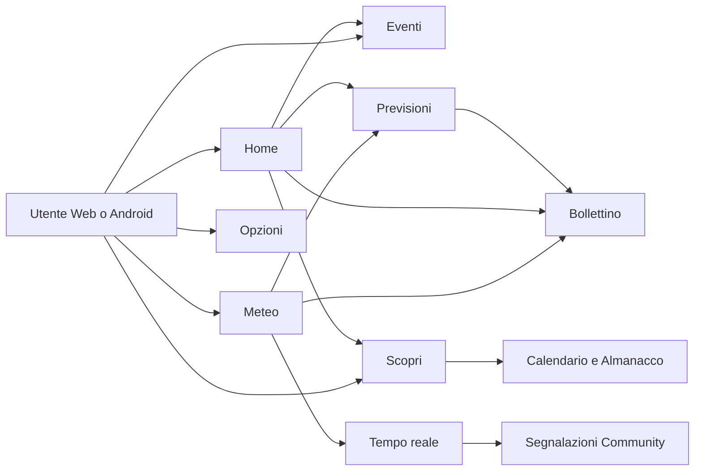
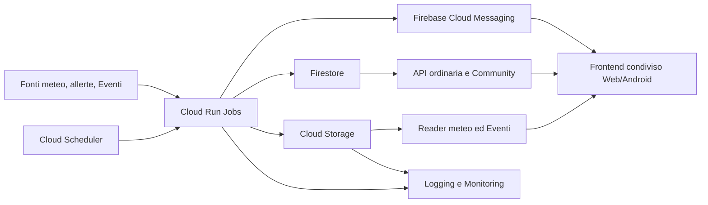

# Meteo Friûl: mappa dell'app e dei flussi — 25 novembre 2026

## Perimetro e modo di leggere la mappa

Questa mappa descrive il codice di `main` al commit `61ca8e5e` e i confini dei
servizi che l'app usa. Il [registro dei job](JOBS_INVENTORY.md) spiega le
pianificazioni; l'[audit operativo del 25 novembre](JOBS_READONLY_AUDIT_20261125.md)
registra separatamente quanto osservato nel cloud. Una route nel codice non
dimostra che quel servizio riceva traffico; un job riuscito non dimostra che il
dato pubblicato sia fresco. Per questi punti si usa la verifica operativa.

I quattro tab principali sono Home, Meteo, Eventi e Scopri. `bulletin` e `live`
sono sottopagine di Meteo; Almanacco e Opzioni sono route aggiuntive, non tab.
La fonte della navigazione è [appConfig.js](../../frontend/src/app/appConfig.js)
con [AppRoutes.jsx](../../frontend/src/app/AppRoutes.jsx). La shell, lo stato
della route, la località, la lingua IT/FUR, il tema, i permessi e le preferenze
sono coordinati da [App.jsx](../../frontend/src/app/App.jsx).

Nell'esperienza pilota la route Almanacco porta a Scopri. Lo storico di
navigazione pilota è in memoria e Home è la radice. La domanda «I perché»
della Home conserva l'identità della scheda e apre il relativo contenuto in
Scopri. Un push meteo o di allerta porta al Bollettino attraverso il gestore
dei deep link, con controlli sulla località corrente.
([pilotRouteHistory.js](../../frontend/src/app/pilotRouteHistory.js),
[HomeQuickGrid.jsx](../../frontend/src/features/home/HomeQuickGrid.jsx),
[pushDeepLink.js](../../frontend/src/services/pushDeepLink.js)).

## Pagine, funzioni e collegamenti

| Vista | Cosa mostra e da dove arriva | Collegamenti e confini |
| --- | --- | --- |
| **Home** | Meteo corrente e orario ICON, ambiente CAMS, bollettino/allerta, anteprima Eventi, calendario e contenuto Scopri. Compone controller e modelli usati dalle altre sezioni; non possiede un proprio job di acquisizione. | Apre Previsioni, Bollettino, Eventi e Scopri. Le anteprime Eventi e «I perché» riusano le rispettive identità. [Home](../../frontend/src/features/home/), [composizione](../../frontend/src/app/AppRoutes.jsx). |
| **Meteo → Previsioni** | Previsione locale ICON e componenti CAMS/UV; lettura del data plane meteo autonomo. CAMS può completare dopo il primo render. | Link al Bollettino quando è pertinente un'allerta. [WeatherForecastView.jsx](../../frontend/src/features/weather/WeatherForecastView.jsx), [weatherApi.js](../../frontend/src/services/weatherApi.js). |
| **Meteo → Bollettino** | Bollettino e allerte ufficiali ARPA FVG/OSMER per FVG; percorso DPC per le allerte nazionali fuori FVG. Radar e bollettino sono informazioni distinte. | Riceve link da Home, Previsioni e notifiche. [Bollettino](../../frontend/src/features/bulletin/), [API meteo ordinaria](../../backend/app/api/weather.py). |
| **Meteo → Tempo reale** | Radar DPC, webcam, mappa territoriale e segnalazioni Community. Feed, radar e webcam hanno lettori e cache separati. | La località scelta orienta la lettura; l'invio di una segnalazione richiede una posizione corrente idonea, distinta dalla scelta manuale. [LiveView.jsx](../../frontend/src/features/live/LiveView.jsx), [servizio Community](../../frontend/src/services/localCommunityPilot.js). |
| **Eventi** | Catalogo, filtri, programma e dettaglio provenienti dal servizio Eventi dedicato; cache client e gate di freschezza/qualità. Home ne mostra l'anteprima. | Il catalogo pubblicato dal job viene letto dall'API, che esclude lotti non verificati; una fonte `partial` non equivale a un guasto totale. [EventsView.jsx](../../frontend/src/features/events/EventsView.jsx), [eventsApi.js](../../frontend/src/services/eventsApi.js). |
| **Scopri** | Calendario e santo, «I perché», profilo del Comune o memoria locale, detti, riti, archivio. Cataloghi editoriali inclusi nel frontend, selezionati per data/località. | Home riusa il modello Scopri e la stessa scheda «I perché». La selezione quotidiana è locale: non esiste un job Scopri giornaliero. [DiscoverView.jsx](../../frontend/src/features/discover/DiscoverView.jsx), [modello](../../frontend/src/features/discover/discoverViewModel.js). |
| **Almanacco** | Santi, proverbi, consigli per la terra, sole e luna da cataloghi e calcoli locali. | Route autonoma nel percorso ordinario, ricondotta a Scopri nell'esperienza pilota. [Almanacco](../../frontend/src/features/almanac/), [dati](../../frontend/src/data/almanac/). |
| **Opzioni** | Lingua, tema, località, GPS, push, profilo Community, privacy, supporto e reset delle cache. | I permessi Android/Web restano distinti. Il reset comprende meteo, Eventi, Bollettino, Live, radar e geocodifica; non è la cancellazione dei dati cloud. [SettingsView.jsx](../../frontend/src/features/settings/SettingsView.jsx), [runtimeDeviceCache.js](../../frontend/src/services/runtimeDeviceCache.js). |

La promozione è un componente condiviso di Home, Eventi e Scopri. Il client
legge `/api/promotions/catalog`; la presenza del componente non prova che
esistano campagne attive. La gestione editoriale delle promozioni e il pannello
sono confini separati.
([PromotionPlacementCard.jsx](../../frontend/src/features/promotions/PromotionPlacementCard.jsx),
[promotions.py](../../backend/app/api/promotions.py)).

### Funzioni trasversali

| Funzione | Regola e pagine coinvolte | Codice guida |
| --- | --- | --- |
| **Località** | La località selezionata alimenta meteo, Eventi e contesto Home; la posizione precisa del dispositivo richiede consenso e non diventa automaticamente località pubblicata. Fuori FVG alcuni contenuti territoriali restano in ambito FVG, mentre meteo/allerte nazionali seguono il proprio gate. | [editorialContext.js](../../frontend/src/app/editorialContext.js), [deviceLocation.js](../../frontend/src/services/deviceLocation.js), [productScope.js](../../frontend/src/domain/scope/productScope.js). |
| **Lingua e tema** | Italiano/friulano e tema sono stato condiviso; Scopri/Almanacco leggono copy e cataloghi locali, gli altri servizi possono restituire testi ufficiali con propria provenienza. | [App.jsx](../../frontend/src/app/App.jsx), [copy](../../frontend/src/copy/). |
| **Push e apertura** | Registrazione dispositivo, preferenze, permessi, outbox e apertura della pagina sono passaggi distinti. Web usa Firebase Messaging/service worker; Android usa adapter nativo e canali. | [pushDeviceRegistration.js](../../frontend/src/services/pushDeviceRegistration.js), [firebaseWebMessaging.js](../../frontend/src/services/firebaseWebMessaging.js), [nativePushAdapter.js](../../frontend/src/services/nativePushAdapter.js). |
| **Community** | Report, conferme, reputazione, identità, moderazione, privacy e persistenza formano una funzione trasversale; Tempo reale è solo una delle superfici. | [community](../../frontend/src/features/community/), [settings](../../frontend/src/features/settings/), [backend Community](../../backend/app/pilot_community_cloud.py). |
| **Cache e aggiornamento** | Controller e cache per dominio impediscono richieste duplicate e distinguono dato fresco, degradato e conservato. Reset dispositivo e aggiornamento dei job cloud sono azioni differenti. | [services](../../frontend/src/services/), [runtimeDeviceCache.js](../../frontend/src/services/runtimeDeviceCache.js). |

### Dove si trova il codice

`frontend/src/app/` coordina route e stato; `frontend/src/features/` contiene
le viste per funzione; `frontend/src/services/` gli adapter HTTP, nativi e le
cache; `frontend/src/domain/`, `copy/` e `data/` modelli, testi e cataloghi.
`frontend/src/ui/` è la shell condivisa. `backend/app/api/` monta le route
FastAPI, mentre `backend/app/events/`, `backend/app/jobs/` e
`experiments/weather_autonomy/` contengono percorsi operativi distinti.
`contracts/` conserva invarianti dei payload, `scripts/` i comandi di
sviluppo/deploy e i controlli, `frontend/android/` il wrapper nativo.
Questa ripartizione è una mappa di manutenzione, non un motivo per spostare
fonti fra sezioni. ([README](../../README.md#architettura),
[AGENTS.md](../../AGENTS.md)).

## Flussi dei dati e risorse

| Risorsa o servizio | Ruolo nel prodotto | Identità e confine da non confondere |
| --- | --- | --- |
| **Cloudflare Pages** | Serve gli asset Web/PWA di `meteofriul.app`. | Il browser usa la base API configurata nella build; `firebase.json` conserva un Hosting legacy con redirect, non descrive da solo il deployment Web corrente. [README](../../README.md#architettura), [config API](../../frontend/src/services/apiConfig.js), [firebase.json](../../firebase.json). |
| **Capacitor/Android** | Include lo stesso frontend compilato, con adapter nativi per posizione, push e impostazioni. | L'endpoint API Android deve essere HTTPS assoluto. Build, installazione e Play sono azioni separate; non esiste wrapper iOS nativo nel repository. [frontend/android](../../frontend/android/), [config API](../../frontend/src/services/apiConfig.js). |
| **Reader meteo FVG** | Legge artefatti ICON e CAMS da Storage ed espone `/weather/v1/...`. | Il provider meteo ufficiale del frontend è autonomo ICON/CAMS. Le vecchie route Open-Meteo nella FastAPI generale non sono la fonte delle Previsioni correnti. [weatherProviderRuntime.js](../../frontend/src/services/weatherProviderRuntime.js), [cloud_reader.py](../../experiments/weather_autonomy/cloud_reader.py). |
| **Reader meteo nazionale** | Espone bundle e documenti ICON nazionali `/weather/v2/icon2i/...`. | Capacità nazionale distinta dal catalogo FVG e soggetta al gate di prodotto. [national_cloud_reader.py](../../experiments/weather_autonomy/national_cloud_reader.py). |
| **API FastAPI ordinaria** | Località, bollettino/allerte/radar, webcam, push, route legacy di Eventi e Community, promozioni e API amministrative. | L'host/base URL conta: alcune route hanno lo stesso path di servizi dedicati. [main.py](../../backend/app/main.py). |
| **Servizio Eventi dedicato** | Legge da Storage il catalogo validato dal job; GET `/api/local/events` con cache di processo di 60 secondi. | La FastAPI ordinaria conserva un `/api/local/events` legacy on demand: non è il catalogo operativo letto in produzione. [pilot_http.py](../../backend/app/events/pilot_http.py), [eventsApi.js](../../frontend/src/services/eventsApi.js). |
| **Servizio Community dedicato** | Gestisce report, identità, moderazione e persistenza del percorso Community corrente. | Distinto dalle route Community presenti nella FastAPI ordinaria; mutazioni protette da App Check. [pilot_community_cloud.py](../../backend/app/pilot_community_cloud.py), [contratto privacy](COMMUNITY_PRIVACY_DATA_SAFETY_HANDOFF.md). |
| **Storage** | Artefatti meteo, catalogo Eventi e snapshot di alcuni servizi. | Un oggetto nuovo può contenere lotti Eventi `stale`; puntatore e contenuto vanno letti insieme. [pilot_cloud.py](../../backend/app/events/pilot_cloud.py), [cloud_worker.py](../../experiments/weather_autonomy/cloud_worker.py). |
| **Firestore e FCM** | Snapshot di allerte, registrazioni push, outbox e stato amministrativo; FCM accetta gli invii verso dispositivi idonei. | Accettazione FCM non dimostra visualizzazione sul telefono. Le outbox FVG, DPC e avvisi locali sono distinte. [push.py](../../backend/app/repositories/push.py), [fcm.py](../../backend/app/push/fcm.py). |
| **Logging, Monitoring e pannello owner** | Riepiloghi esecutivi, policy e diagnostica. | L'endpoint owner `/api/admin/operations` legge mattino, sera ed Eventi; non è un inventario di tutti i job. [operations_admin.py](../../backend/app/api/operations_admin.py), [policy](../../scripts/cloud-run-job-monitoring-policies.json). |
| **Geocodifica** | Catalogo comunale ISTAT/FVG e reverse FVG offline; ricerca esterna nazionale filtrata via Nominatim. | Nominatim aiuta a scegliere la località, non è un provider meteo. La posizione precisa non viene salvata come punto pubblico di previsione. [location.py](../../backend/app/api/location.py), [dati geografici](../../backend/app/data/). |
| **Asset e mappe** | Asset astronomici e immagini/stemmi comunali versionati; basemap CARTO per la mappa Tempo reale, tile radar dalla fonte DPC e immagini webcam dai rispettivi gestori. | La chiave CARTO è un parametro client limitato ai domini/app autorizzati, non viene riportata qui; disponibilità delle immagini esterne e diritto di riuso sono controlli distinti. [astronomy](../../frontend/public/astronomy/), [municipalities](../../frontend/public/municipalities/), [Live](../../frontend/src/features/live/). |

### Fonti per dominio e catena di consumo

- **ICON FVG e nazionale:** job produttori → Storage → reader meteo → Home,
  Previsioni e, secondo territorio, avvisi/sintesi. Il monitor ICON controlla
  freschezza e confronto Storage/HTTP separatamente dai produttori.
- **CAMS:** acquisizione aria, pollini e UV in slot differenti → Storage/reader
  meteo → componenti ambiente in Home e Previsioni. Successo del container e
  presenza di tutte le componenti sono prove diverse.
- **Allerte FVG:** fonte ufficiale → snapshot Firestore → Bollettino/Home e
  possibile push. Lo stato senza allerta ha validità di 150 minuti: due ore
  fra corse più 30 minuti di margine. [official_alerts.py](../../backend/app/services/official_alerts.py).
- **Allerte DPC nazionali:** sync e persistenza separati dal job di invio →
  snapshot nazionale → Bollettino e push per località idonee. Il sync non
  invia notifiche. [sync](../../backend/app/jobs/sync_national_official_alerts.py),
  [send](../../backend/app/jobs/send_national_official_alerts.py).
- **Eventi:** fonti approvate → adattatori e gate nel job →
  `pilot/events/v1/catalog.json` → servizio Eventi → Home/Eventi. Lotti
  `stale` sono conservati per diagnosi ma esclusi dalla risposta pubblica;
  `partial` conserva solo schede verificate. [pilot_cloud.py](../../backend/app/events/pilot_cloud.py),
  [pilot_http.py](../../backend/app/events/pilot_http.py).
- **Scopri/Almanacco:** cataloghi IT/FUR versionati nel frontend → selettori
  temporali/locali → Home e Scopri. Non passano da Cloud Scheduler. Lo stato
  bilingue del catalogo «I perché» non costituisce verifica fattuale:
  i suoi [metadati](../../frontend/src/data/discover/pilotWhyCatalog.json)
  dichiarano revisione indipendente e certificazione linguistica assenti.
- **Community e Live:** lettura/report dal servizio dedicato, radar DPC,
  webcam e API ordinaria sono percorsi distinti. La posizione del telefono
  usata per un report non è automaticamente il Comune selezionato.

## API, cache e protezioni

La FastAPI generale monta i router in [main.py](../../backend/app/main.py):
`/api/location`, `/api/weather`, `/api/live`, `/api/community`,
`/api/push/devices`, `/api/local/events` legacy, `/api/promotions` e
`/api/admin/*`. Meteo corrente/forecast/bootstrap legacy sono presenti nel
codice ma non vanno usati per dedurre il provider corrente. Il servizio Eventi
dedicato espone lo stesso path pubblico su un altro host; Community ha un
servizio separato. Il frontend seleziona le basi per dominio e per modalità
Web/Android/pilota. ([weather.py](../../backend/app/api/weather.py),
[events.py](../../backend/app/api/events.py),
[eventsApi.js](../../frontend/src/services/eventsApi.js)).

Le cache sono per dominio e hanno stati espliciti di staleness o degrado;
HTTP 200, cache presente e dato fresco non sono sinonimi. Le mutazioni
Community e push richiedono App Check. Le API amministrative richiedono
identità/claim proprietario; in particolare `POST
/api/admin/events/sources/{name}/verify` **avvia una verifica** e non è una
lettura innocua. Il rapporto operativo usa solo GET e CLI di lettura.

### Indice delle interfacce HTTP del repository

La tabella enumera le **famiglie di endpoint montate nel codice `main`**.
Per una route omonima serve sempre l'host/base URL: questo indice non
certifica da solo il traffico di produzione. I parametri e i payload sono
nei contratti e nei file collegati.

| Servizio | Route e funzione | Stato nel flusso dell'app |
| --- | --- | --- |
| FastAPI UI3, località | `GET /api/location/search`, `GET /api/location/municipalities/search`, `POST /api/location/reverse`, `GET /api/location/reverse` deprecato. | Scelta e risoluzione della località; il reverse FVG usa geografia locale. [location.py](../../backend/app/api/location.py). |
| FastAPI UI3, meteo/ufficiale | `GET /api/weather/current`, `/forecast`, `/bootstrap` legacy; `GET /api/weather/official-alerts`, `/official-alerts/national`, `/radar`. | Le tre route legacy non producono la previsione ICON/CAMS corrente; Bollettino, allerte e metadati radar restano qui. [weather.py](../../backend/app/api/weather.py). |
| FastAPI UI3, Live/Community legacy | `GET /api/live/webcams`, `GET /api/community/reports`; `POST /api/community/reputation`, `/community/reports`, `/community/reports/{group_id}/confirmation`, `/community/reports/{group_id}/flags`; `DELETE /api/community/reports/{report_id}`. | Webcam e percorso Community storico, distinto dal servizio Community dedicato. [live.py](../../backend/app/api/live.py). |
| FastAPI UI3, Eventi legacy | `GET /api/local/events`, `/api/local/events/detail`, `/api/event-images/{filename}`. | Percorso on demand rimasto nel backend generale, non il reader del catalogo operativo. [events.py](../../backend/app/api/events.py). |
| FastAPI UI3, push | `POST /api/push/devices/register`, `/unregister`, `/location`. | Registrazione, revoca e aggiornamento della località dei dispositivi idonei. [push.py](../../backend/app/api/push.py). |
| FastAPI UI3, promozioni | `GET /api/promotions/catalog`, `POST /api/promotions/events`; owner `GET /api/admin/promotions/state`, `/availability`, `POST /import-site`, `PUT /state`. | Catalogo pubblico/telemetria e gestione separata; un endpoint esistente non implica campagne attive. [promotions.py](../../backend/app/api/promotions.py). |
| FastAPI UI3, owner | `GET /api/admin/events/sources`, `PUT /{name}`, `POST /{name}/verify`; `GET /api/admin/operations`; `GET/PUT /api/admin/webcams/state`. | Controllo fonti, pannello operativo e override webcam. `verify` avvia lavoro. [events_admin.py](../../backend/app/api/events_admin.py), [operations_admin.py](../../backend/app/api/operations_admin.py), [webcam_admin.py](../../backend/app/api/webcam_admin.py). |
| FastAPI UI3, infrastruttura | `GET /healthz`, `/api/healthz`, `/api/docs`, `/api/openapi.json`. | Salute e descrizione API, non qualità dei dati pubblicati. [main.py](../../backend/app/main.py). |
| Reader Eventi dedicato | `GET /health`, `GET /api/local/events`. | Catalogo Storage validato e filtrato, usato dal client Eventi in produzione. [pilot_http.py](../../backend/app/events/pilot_http.py). |
| Community dedicata | `GET /api/community/health`, `/reports`; `POST /reports/query`, `/history`, `/resolve`, `/reports`, `/reports/{report_id}/correction`, `/operations/{operation_id}`, `/reports/{group_id}/confirmation`, `/reports/{group_id}/flags`, `/reputation`; `DELETE /reports/{report_id}`. | Report, lettura e operazioni nel servizio Community separato; path abbreviati dopo `/api/community`. [pilot_community_cloud.py](../../backend/app/pilot_community_cloud.py). |
| Reader meteo dedicati | `/weather/v1/...` per FVG/CAMS e `/weather/v2/icon2i/...` per nazionale. | Manifest, documenti e puntatori pubblicati dai worker. Le route specifiche e i contratti di payload sono nei reader. [cloud_reader.py](../../experiments/weather_autonomy/cloud_reader.py), [national_cloud_reader.py](../../experiments/weather_autonomy/national_cloud_reader.py). |

### Indice delle persistenze principali

| Risorsa | Scrittura → lettura | Limite |
| --- | --- | --- |
| Storage `pilot/events/v1/catalog.json` | Job Eventi → reader Eventi. | Una generazione nuova può contenere lotti `stale`; l'API li esclude. |
| Storage `weather/v1/...` e `weather/v2/icon2i/pilot.json` | Worker ICON/CAMS → reader meteo; monitor confronta Storage/HTTP. | Data del puntatore, ciclo della fonte e validità vanno letti insieme. |
| Firestore `official_alert_snapshots` e `national_official_alert_snapshots` | Sync FVG/DPC → API ufficiali e circuiti push. | Le due geografie non condividono automaticamente stato o invio. |
| Firestore `push_devices` e outbox distinte | Registrazione e job di invio → FCM. | L'outbox previene duplicati; FCM accettato non equivale a telefono raggiunto. |
| Stato amministrativo promozioni/webcam | API owner → cataloghi/manifest letti dal client. | La loro presenza non è prova di una campagna o anteprima attiva. |
| Snapshot Community | Servizio dedicato → Storage con puntatore Firestore. | Identità, moderazione e privacy restano nel contratto Community. |

La mappa è completa **a livello di superfici e confini del repository**:
non elenca ogni componente React, helper, campo JSON o risorsa interna dei
progetti esterni. I link ai moduli e ai contratti sono l'indice per quel
dettaglio; lo stato distribuito si trova nel verbale datato.

## Job, monitoraggio e pubblicazione

La [mappa dei job](JOBS_INVENTORY.md) specifica per ogni Scheduler nome,
orario/fuso, funzione, ingresso, uscita e ragione della separazione.
La verifica di oggi è nel [verbale](JOBS_READONLY_AUDIT_20261125.md).
Il cloud contiene anche job senza Scheduler, prove e risorse che non sono
allineate automaticamente al codice di `main`: sono inventariati con uno
stato distinto. Le policy Monitoring possono rilevare una corsa fallita o
l'assenza di successi; non certificano da sole freschezza dei dati, consegna
di email o visualizzazione di push.

Web e Android condividono il frontend approvato, ma preparazione, verifica,
deploy Web, APK/AAB e pubblicazione Play sono passaggi separati. Le regole
di parità e i gate sono nel [runbook Web/Android](WEB_ANDROID_RELEASE_PARITY.md)
e nel [runbook Play](PLAY_AAB_RUNBOOK.md). Questo audit non compila né
pubblica un artefatto.

## Confini, documenti storici e lacune

- La landing page e il pannello editoriale sono progetti esterni: qui sono
  mappati i loro confini API e i deploy documentati, non l'intero codice di
  quei progetti.
- [UI3_RUNTIME_DATA_INVENTORY.md](../../UI3_RUNTIME_DATA_INVENTORY.md),
  [PILOT_APP_COMPLETE_ARCHITECTURE_2026-09-12.md](PILOT_APP_COMPLETE_ARCHITECTURE_2026-09-12.md)
  e parti di [backend/README.md](../../backend/README.md) descrivono fasi
  precedenti. In particolare citano Open-Meteo o un progetto pilota isolato,
  Eventi on demand, push non attivo e un reset cache che non toccherebbe il
  Bollettino. Il codice corrente è descritto sopra; quelle fonti restano
  testimonianze datate.
- La presenza di API/admin, cataloghi e job nel repository non prova quale
  immagine sia distribuita o quale versione dei dati sia leggibile oggi.
  Immagine, Scheduler, esecuzione e risultato sono verificati separatamente
  nel verbale operativo, con le parti non osservabili marcate come tali.
