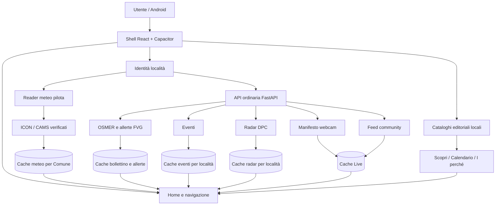

# Mappa completa dell'app pilota Meteo Eventi Friûl

**Stato descritto:** 12 settembre 2026

**Sorgenti esaminati:** `HEAD 0342eb0`

**Applicazione di riferimento:** Android pilota `com.meteofriul.app.localpilot`

**Versione Android dichiarata:** `1.0.1-local-pilot` (`versionCode 300012`)

**Ambito:** comportamento presente nei sorgenti; nessun audit live di cloud o telefono

Questo documento è la mappa funzionale e tecnica complessiva della pilota. Copre
shell, avvio, località, GPS, Home, meteo, bollettino, eventi, Scopri, radar,
webcam, community, notifiche, impostazioni, cache, API, persistenza, sicurezza e
modalità di errore.

Per ICON-2I, OSMER, CAMS aria/pollini, CAMS UV, pubblicazioni cloud e modello di
cache `attivo + candidato`, il riferimento di dettaglio è
[`PILOT_WEATHER_DATA_ARCHITECTURE_2026-09-12.md`](PILOT_WEATHER_DATA_ARCHITECTURE_2026-09-12.md).
Qui quei flussi sono riassunti e collegati al resto dell'app.

Le affermazioni sul funzionamento derivano dai sorgenti e dai test correnti. I
dossier storici sono citati solo come supporto: quando divergono dal codice,
questo documento segnala esplicitamente la divergenza.

## 1. Vista d'insieme

La pilota è una SPA React inclusa in un contenitore Android Capacitor. Non è una
singola pagina che parla con un singolo server: combina quattro classi di dati.

1. **Meteo autonomo della pilota**
   - ICON-2I, aria, pollini e UV;
   - artefatti prodotti nel progetto isolato `meteofriul-pilot-20260906`;
   - lettura dal servizio `pilot-weather`;
   - controlli crittografici e semantici anche sul telefono.
2. **Servizi ordinari Meteo Friûl**
   - bollettino OSMER, allerte regionali, radar, eventi, webcam, community,
     risoluzione geografica e registrazioni push;
   - API FastAPI sotto `/api`.
3. **Cataloghi editoriali inclusi nell'app**
   - Calendario, santi, proverbi, consigli per la terra, memorie, tradizioni,
     profili comunali e `I perché del Friûl`;
   - nessuna richiesta di rete per comporre Scopri.
4. **Capacità native del dispositivo**
   - GPS in primo piano;
   - gestione del tasto Indietro e apertura impostazioni di sistema;
   - nella build condivisa esistono push e localizzazione in background, ma la
     variante `localPilot` li disattiva come precisato nelle sezioni 5 e 14.



### Le quattro aree di prodotto

La barra inferiore espone quattro voci:

| Scheda | Funzione |
|---|---|
| Home | sintesi immediata di località, meteo, allerta/bollettino, prossime ore, evento e contenuti editoriali |
| Meteo | previsione locale; da questa famiglia si raggiungono anche Bollettino e Live |
| Eventi | appuntamenti raccolti dalle fonti territoriali e filtrati per luogo e data |
| Scopri | cultura friulana, calendario, memorie, usi, tradizioni, storia locale e `I perché` |

`Live` non è un quinto pulsante principale: è una sottorotta dell'area Meteo e
riunisce radar, webcam e segnalazioni della community.

## 2. Identità della pilota e confini con la beta

### 2.1 Pacchetto e build

La configurazione Android di base usa:

```text
applicationId = com.meteofriul.app
versionName   = 1.0.1
versionCode   = 300012
```

Il build type `localPilot` aggiunge:

```text
applicationIdSuffix = .localpilot
versionNameSuffix   = -local-pilot
LOCAL_WEATHER_PILOT = true
debuggable          = true
```

Il risultato è installabile accanto alla beta senza sostituirla. Lo script
protetto `scripts/build-android-local-weather-pilot.ps1`:

- richiede un endpoint API HTTPS esplicito e taggato;
- costruisce gli asset web in una directory temporanea del sistema;
- verifica i marker del build pilota;
- controlla l'identità del pacchetto generato;
- controlla l'icona launcher approvata;
- non produce né pubblica una release Play.

### 2.2 Due endpoint distinti

Nel pacchetto pilota convivono:

- `VITE_ANDROID_API_BASE`: API ordinaria per bollettino, allerte, eventi,
  radar, webcam, community, location e push;
- `VITE_LOCAL_WEATHER_PILOT_API_BASE`: reader dedicato agli artefatti ICON/CAMS.

Cambiare la fonte meteo della pilota non sposta automaticamente gli altri
servizi sul progetto pilota meteo.

### 2.3 Attivazione fail-closed

La modalità pilota viene riconosciuta solo con una combinazione esatta di:

- modalità Vite prevista;
- flag frontend;
- flag Android di build;
- runtime Android nativo oppure sviluppo loopback, a seconda del caso;
- host locale `localhost`/loopback del WebView.

Una configurazione parziale non abilita silenziosamente il provider autonomo.

### 2.4 Differenze effettive della variante `localPilot`

La variante pilota corrente:

- usa il meteo autonomo ICON/CAMS;
- conserva GPS in primo piano;
- rimuove dal manifest `ACCESS_BACKGROUND_LOCATION`;
- annulla il prefetch meteo predittivo legacy basato sul worker condiviso;
- fa restituire `null` all'adapter delle notifiche push native;
- non possiede una propria identità Firebase Android.

Conseguenze:

- non riceve push ufficiali o avvisi meteo locali;
- non esegue il ciclo GPS in background descritto nella sezione 5.8;
- può leggere feed community e webcam, perché le letture sono pubbliche;
- le mutazioni community protette da App Check non possono completarsi contro
  un backend in enforcement se il pacchetto non può ottenere un token Firebase.

L'ultima conseguenza è dedotta dal grafo di build e dagli adapter correnti; non è
una prova live eseguita in questa ricognizione. La UI condivisa considera Android
capace di segnalare, ma il plugin App Check della `localPilot` non dispone di una
Firebase app inizializzata. È quindi un limite funzionale da non confondere con
un errore del feed pubblico.

## 3. Shell, navigazione e ciclo di vita

### 3.1 Montaggio dell'app

`frontend/src/main.jsx` monta `App` in `React.StrictMode`. `App.jsx` è
l'orchestratore globale: conserva località, lingua, tema, route, stato push,
stato GPS, refresh, allerta ufficiale, undo community e overlay di startup.

### 3.2 Header

Nella pilota l'header mostra:

- marchio `Meteo Eventi Friûl`;
- payoff localizzato IT/FUR;
- pulsante per alternare la lingua;
- pulsante Impostazioni.

Durante l'invio di una nuova segnalazione community, i controlli che
cambierebbero pagina vengono bloccati per non smontare il flusso prima
dell'esito. Il blocco globale non copre conferme, segnalazioni di abuso o undo.

### 3.3 Route

Route riconosciute:

```text
home
weather
events
discover
bulletin
live
almanac
settings
```

Nella pilota `almanac` viene reso tramite `discover`. Le route `weather`,
`bulletin` e `live` appartengono alla stessa famiglia Meteo; lo swipe fra esse
è disabilitato nella pilota, mentre restano disponibili le azioni esplicite.

Quando l'utente si trova in Eventi o Scopri, un'allerta ufficiale attiva può
comparire come badge separato sopra il pulsante Meteo. Il badge non viene usato
per uno stato stale o non autorevole.

### 3.4 Rimontaggio al cambio località

La chiave della vista è:

```text
${activeTab}:${getLocationCacheKey(location)}
```

Il cambio di scheda o di identità geografica rimonta la pagina. Questo evita che
stato locale, filtri o una risposta della località precedente restino agganciati
alla nuova località. I controller aggiungono anche guardie `latest-wins` per le
risposte asincrone.

### 3.5 Cronologia e tasto Indietro

La cronologia pilota:

- esiste soltanto in memoria;
- parte sempre da Home;
- conserva circa le ultime 30 visite non-Home;
- tornando a Home azzera la pila;
- non scrive la cronologia nel browser o in `localStorage`.

Il tasto Android Indietro chiude prima l'overlay più alto, per esempio dialogo o
foglio località; solo dopo torna alla route precedente. In Scopri cancella anche
l'eventuale `whyId` congelato per quella visita.

### 3.6 Pull-to-refresh

Il gesto parte soltanto quando il contenuto è in cima e il tocco non nasce su
controlli interattivi, header, barra inferiore, foglio località, mappa o tab.

Costanti correnti:

| Parametro | Valore |
|---|---:|
| blocco direzione | 28 px |
| soglia di attivazione | 172 px |
| corsa massima | 224 px |
| rapporto di trascinamento | 0,58 |
| feedback minimo | 1.400 ms |
| feedback esito | 1.100 ms |
| distanza durante refresh | 76 px |

Il messaggio generale di successo/fallimento aggrega l'esito della route e la
verifica delle allerte ufficiali. `Fallito` non equivale quindi automaticamente
a “CAMS fallito”, “eventi falliti” o “cache cancellata”. I dati già visibili
restano, se il controller del dominio li considera ancora utilizzabili.

### 3.7 Ritorno in primo piano

Il runtime ascolta `focus`, `visibilitychange`, `online` e resume Capacitor.
La pilota limita il refresh generale a una verifica ogni 10 minuti; il percorso
ordinario usa finestre più brevi. Ogni route decide poi se la propria cache evita
una nuova richiesta.

## 4. Stato persistente sul dispositivo

Questa tabella raccoglie le chiavi principali. Le cache meteo specializzate sono
descritte nel documento meteo collegato.

| Chiave/storage | Contenuto | Durata logica |
|---|---|---|
| `defaultLocation` / localStorage | località attiva normalizzata | persistente |
| `recentLocations` / localStorage | massimo 6 località recenti | persistente |
| `autoLocationEnabled` / localStorage | scelta GPS automatico | persistente |
| `mfLanguage` / localStorage | `it` o `fur` | persistente |
| `mfTheme` / localStorage | `light`, `dark`, `system` | persistente |
| `mfNotificationPreferences:v1` / localStorage | allerta ufficiale e avvisi meteo | persistente |
| `mfWebStartupOnboarding:v1` / localStorage | `completed` o `dismissed` | persistente |
| `mfPushInstallationId:v1` / localStorage | ID casuale 32 hex | persistente |
| `eventsCache:v12...` / localStorage | eventi per località e limite | massimo 48 h |
| `bulletinRadarCache:v2...` / localStorage | metadati radar per località | massimo 30 min |
| `liveWebcamManifest:v1` / localStorage | manifesto webcam | massimo 7 giorni |
| `liveCommunityReports:v1` / localStorage | feed community | massimo 65 min |
| `meteoFriul:communityClientId:v1` / localStorage | identità installazione community | persistente |
| `meteoFriul:communitySessionClientId:v1` / sessionStorage | copia identità sessione | sessione |
| `meteoFriul:communityGuidelinesConsent:v1` / localStorage | consenso e versione regole | persistente finché versione coincide |
| `meteoFriul:communityPersonal:v1` / localStorage | report propri, voto e contatore | scadenze del dominio |
| `meteoFriul:communityModeration:v1` / localStorage | contenuti/fonti nascosti | 1 h / 24 h |
| `meteoFriul:communityReportUndo:v1` / sessionStorage | possibilità di annullare report | 60 s |

`jsonCache.js` incapsula le cache generiche come `{savedAt,data}`. Rifiuta età
negative e valori oltre il massimo; elimina JSON malformato; assorbe errori di
quota o storage non disponibile senza far cadere l'app.

Non sono persistiti globalmente:

- route corrente, salvo un iniziale `?tab=...`;
- posizione di scroll;
- tab e filtri interni degli Eventi;
- camera selezionata;
- espansioni di Scopri;
- visita specifica a `I perché`.

## 5. Avvio, località e GPS

### 5.1 Stato iniziale

La località di riserva è Udine:

```text
Comune: Udine
Provincia: UD
Regione: Friuli-Venezia Giulia
ISTAT: 030129
source: placeholder
lat/lon top-level: null
```

All'avvio viene prima normalizzato ciò che era stato salvato. Coordinate precise
legacy o non accompagnate da evidenza affidabile vengono rimosse; il punto
canonico `dataPoint` può invece restare.

### 5.2 Onboarding web

Il web usa un overlay in due passaggi:

1. località: GPS oppure scelta manuale;
2. notifiche: richiesta solo se il runtime web è configurato e abilitato.

La chiusura viene registrata come `completed` o `dismissed`. Se lo storage non è
disponibile, l'overlay può comunque chiudersi per la sessione.

### 5.3 Startup Android condiviso

Il flusso Android condiviso ordina:

1. disclosure prominente sulla localizzazione in background;
2. richiesta della posizione/località;
3. fallback manuale se necessario;
4. verifica/richiesta notifiche.

La `localPilot` non ha il permesso background e non attiva il push, quindi in
questa variante restano rilevanti soprattutto località manuale e GPS foreground.

### 5.4 Ricerca e selezione manuale

La ricerca accetta almeno 2 caratteri e mostra al massimo 8 risultati.

1. Interroga prima il catalogo locale FVG.
2. Interroga `GET /api/location/search?q=...`.
3. Se rete o API falliscono, conserva i risultati locali.
4. Filtra comunque le risposte remote al territorio FVG.

Una scelta nuova usa `source:"manual"`; una località recente usa
`source:"manual_recent"`. Entrambe disattivano la modalità automatica.

Le scorciatoie della pilota sono Udine, Trieste, Gorizia e Pordenone. I recenti
sono deduplicati e limitati a sei.

Nel percorso ordinario il cambio manuale viene confermato dopo un meteo valido,
con timeout esterno di 8 secondi. Nella `localPilot` la nuova identità e la
disattivazione del GPS automatico vengono applicate subito; il caricamento meteo
continua in best effort senza poter ricommittare una località ormai superata.

### 5.5 Acquisizione GPS foreground

Il flusso usa una richiesta singola, non un watcher continuo.

Ordine Android:

1. Capacitor Geolocation;
2. bridge Android legacy solo se necessario;
3. API geolocation del browser come ultima compatibilità.

Un diniego nativo è terminale e non viene aggirato chiedendo al browser.

Stadi Capacitor:

| Stadio | Accuratezza | Cache ammessa | Timeout |
|---|---|---:|---:|
| fast | bassa | 30 s | 1,5 s |
| balanced | bassa | nessuna | 5 s |
| precise | alta | nessuna | 18,5 s |

Il browser usa `enableHighAccuracy:true`, `maximumAge:0`, timeout 25 secondi.

Per aggiornare la località dell'app, il fix deve normalmente avere:

- età massima 2 minuti;
- accuratezza non peggiore di 250 m;
- nel percorso Capacitor/Android, timestamp non oltre 5 secondi nel futuro;
- posizione non mock nel worker nativo condiviso.

Il fallback GPS del browser non applica lo stesso rifiuto esplicito dei
timestamp futuri: calcola invece un'età mai inferiore a zero.

La precisione approssimativa non è accettata per default. L'identità visibile
cambia se cambia Comune/località o se il punto canonico si sposta di almeno
500 m.

### 5.6 Reverse geocoding e identità pubblica

Il client invia:

```http
POST /api/location/reverse
Content-Type: application/json

{"lat": ..., "lon": ..., "accuracyM": ...}
```

Il vecchio `GET /api/location/reverse` resta soltanto per compatibilità ed è
marcato deprecated.

Dentro FVG il backend lavora offline con:

- 215 confini comunali ISTAT 2026, point-in-polygon;
- 2.397 toponimi RAFVG/IRDAT CTRN 5000;
- punto canonico del Comune quando una località più precisa non è dimostrabile.

Una località infra-comunale viene accettata solo se:

```text
distanza + accuratezza + 10 m <= 350 m
```

e se il secondo candidato con nome diverso è sufficientemente più lontano.
Vicino a un confine, il client accetta il Comune soltanto quando:

```text
accuracy + 10 m < distanza dal confine
```

L'uguaglianza resta ambigua e viene rifiutata.

### 5.7 Cosa viene conservato

L'app usa per meteo e presentazione il punto canonico restituito dal resolver,
non il fix preciso grezzo. Conserva come prova:

- `positionAccuracyM`;
- `positionCapturedAt`;
- origine del fix;
- stato di risoluzione;
- eventuale `dataPoint` canonico.

Le coordinate grezze possono transitare nella richiesta di reverse o di update
push background, ma non vengono salvate nel profilo push Firestore.

### 5.8 Automatico in primo piano

Sul web:

- tick di valutazione ogni 60 secondi;
- pagina obbligatoriamente visibile;
- almeno 30 minuti fra controlli normali;
- `online` può forzare un nuovo controllo;
- richieste serializzate e protette da guardia latest-wins.

Su Android, al resume:

- intervallo minimo 3 minuti;
- retry limiter 30 secondi;
- aggiornamento coordinato di posizione, runtime e stato servizi.

Errori permanenti, come permesso negato o API non supportata, disattivano
l'automatico. Timeout, servizio temporaneamente disabilitato, precisione
insufficiente o reverse non raggiungibile durante una modalità già attiva non
cancellano l'ultima località valida.

### 5.9 Architettura background condivisa, non attiva nella `localPilot`

Nella build Android ordinaria, previo consenso esplicito e permesso “sempre”:

- WorkManager pianifica lavoro unico ogni 15 minuti, deferribile dal sistema;
- job immediati possono partire da configure, boot, geofence exit o richiesta;
- il geofence EXIT usa un raggio fra 200 e 500 m;
- il worker prova last location, balanced e precise;
- invia `POST /api/push/devices/location` con App Check;
- dopo una risposta canonica può pre-caricare il meteo ordinario;
- il prefetch si rinnova dopo 30 minuti, cambio città o spostamento canonico di
  almeno 2 km.

La `localPilot` rimuove il permesso background, disabilita il push e annulla il
prefetch predittivo legacy. Il prefetch ICON/CAMS della pilota è un meccanismo
separato e non invia notifiche.

### 5.10 Fuori FVG

Il backend corrente, fuori dai poligoni FVG, consulta Nominatim con coordinate
arrotondate a tre decimali e conserva una cache RAM fino a 30 giorni. Questa
implementazione diverge dal contratto storico che descriveva un reverse
interamente offline.

Ciò **non** rende attiva una modalità nazionale nella pilota:

- la ricerca manuale corrente è filtrata a FVG;
- ICON della pilota usa il catalogo dei 215 Comuni e il codice ISTAT;
- OSMER, allerte, eventi, Scopri e community restano regionali;
- la modalità progettata “fuori FVG: solo meteo ICON” non è implementata;
- non esistono allerte nazionali attive nell'app corrente.

## 6. Home

### 6.1 Composizione

La Home pilota mostra, nell'ordine logico:

1. hero meteo con località e comando Cambia;
2. allerta ufficiale attiva, oppure sintesi del bollettino;
3. griglia rapida con:
   - evoluzione oraria;
   - evento vicino;
   - memoria/editoriale del giorno;
   - `I perché del Friûl`.

Le metriche locali legacy della Home ordinaria non vengono mostrate nella
`localPilot`; aria, pollini e UV vivono nella pagina Meteo.

### 6.2 Caricamento

`homeDataController.js` tratta meteo ed eventi come rami separati:

1. legge immediatamente le cache della località;
2. idrata la vista;
3. avvia meteo ed eventi in parallelo;
4. riconcilia le allerte ufficiali tramite cache regionale distinta;
5. ignora risposte appartenenti a una località non più attiva.

Una Home può quindi avere meteo aggiornato ed eventi stale, o viceversa.

### 6.3 Selezione dell'evento teaser

Il teaser non è semplicemente il primo evento ricevuto. Il modello considera:

- prossimità temporale;
- località e distanza;
- categoria;
- presenza di immagine/link;
- compatibilità limitata con il meteo previsto.

La compatibilità meteo modifica il ranking Home fra circa `-35` e `+25`; non
riordina la pagina completa Eventi e il punteggio non viene mostrato all'utente.

### 6.4 Azioni

- Hero → selettore località.
- Allerta/sintesi → Bollettino.
- Evoluzione → Meteo.
- Evento → Eventi.
- Memoria → ancora pertinente di Scopri.
- `I perché` → Scopri con `whyId` della domanda mostrata.

## 7. Meteo, bollettino, aria, pollini e UV

Questa sezione è una mappa di collegamento. Il comportamento completo è nel
documento meteo dedicato.

| Componente | Fonte | Percorso principale | UI |
|---|---|---|---|
| Meteo locale | ItaliaMeteo ICON-2I | job `pilot-icon` → GCS privato → `pilot-weather` → validatore telefono | Home e Meteo |
| Bollettino | ARPA FVG - OSMER | API ordinaria `/api/weather/forecast` e cache bollettino | Home e Bollettino |
| Allerte | fonte ufficiale regionale FVG | `/api/weather/official-alerts` e runtime regionale | Home, Bollettino, badge |
| Aria | CAMS Europe | ramo aria della famiglia CAMS atomica | Meteo |
| Pollini | CAMS Europe | ramo pollini della stessa famiglia atomica | Meteo |
| UV | CAMS Global | pubblicazione UV indipendente | Meteo |
| Radar | Protezione Civile, SRI/SRT1 | `/api/weather/radar` + tile DPC dirette | Bollettino e Live |

### 7.1 Principio di pubblicazione

I job cloud producono artefatti immutabili e sostituiscono il puntatore pubblico
solo quando una release è completa. Il reader `pilot-weather` legge ma non avvia
job, non possiede credenziali ADS e non calcola valori.

Il refresh del telefono chiede l'ultima pubblicazione disponibile: non avvia
ICON, CAMS o una nuova acquisizione.

### 7.2 Validazione nel telefono

Il runtime verifica, secondo il componente:

- schema e versione;
- identità Comune/ISTAT;
- provenienza e corsa;
- dimensione e SHA-256;
- catena puntatore → manifest/release → payload;
- revoche;
- freschezza, usabilità e copertura oraria.

### 7.3 Cache `attivo + candidato`

Per CAMS e UV il nuovo pacchetto viene:

1. scaricato come candidato;
2. validato;
3. salvato separatamente;
4. riletto;
5. promosso ad attivo solo dopo conferma completa.

Timeout, rete assente, pacchetto incompleto, salvataggio fallito o nuova corsa
non pronta non cancellano l'attivo precedente. Aria/pollini e UV avanzano in
modo indipendente.

### 7.4 Cambio d'ora

L'app seleziona dalla serie attiva il campione pertinente all'ora consultata.
Non congela un numero e non richiede necessariamente rete. Se non esiste un
campione pertinente, può trattenere l'ultima informazione con riferimento
temporale esplicito, senza presentarla come attuale.

### 7.5 Cache del bollettino

- riverifica: 5 minuti;
- conservazione massima dispositivo: 7 giorni;
- fallback stale esplicito, senza trasformarlo in dato fresco.

Le condizioni locali normalizzate del Bollettino hanno riverifica 10 minuti e
conservazione massima 3 ore.

### 7.6 Limiti geografici

La pilota meteo autonoma resta vincolata ai 215 Comuni FVG. OSMER e allerte sono
regionali. Non va presentata come copertura nazionale né come sistema nazionale
di avvisi meteo.

## 8. Eventi

### 8.1 Flusso della pagina

Costanti frontend:

```text
raggio corrente della pilota = 20 km
Home event limit             = 8
pagina completa              = 100
retry massimi pending        = 20
intervallo retry             = 2,5 s
orizzonte UI                 = 15 giorni
```

La route:

1. legge la migliore cache disponibile;
2. tenta una richiesta anche se la cache è presente;
3. chiede fino a 100 eventi;
4. se il backend risponde `refreshing` o `partial`, riprova fino a 20 volte;
5. non cancella una cache buona a causa di una risposta temporanea peggiore;
6. ignora una risposta se nel frattempo la località è cambiata.

Il selettore riusabile ammette 5–50 km a passi di 5, ma nella UI pilota corrente
non è collegato: il raggio effettivo resta 20 km.

### 8.2 Quale backend usa davvero la APK pilota

Il codice contiene due trasporti compatibili:

1. **API ordinaria**: `${API_BASE}/local/events`;
2. **servizio autonomo `pilot-events`**: attivato nel client soltanto quando
   `API_BASE` coincide esattamente con
   `https://pilot-events-335641913741.europe-west1.run.app/api`.

Il percorso di build protetto documentato per la APK `localPilot` riceve invece
l'endpoint API ordinario taggato. Pertanto la APK corrente usa il backend eventi
standard; la pipeline autonoma `pilot-events` esiste nel repository e nel cloud,
ma non viene selezionata automaticamente dal solo flag meteo pilota.

### 8.3 Fonti del backend standard

Il motore raccoglie in parallelo:

1. TurismoFVG;
2. SagreFVG;
3. Pro Loco FVG;
4. Paesi in Festa;
5. Anteprima Sagre;
6. EventiFVG.

Villa Manin ed ERPAC restano fonti shadow/guarded: possono essere acquisite e
valutate, ma non entrano automaticamente nel feed finché il gate manuale di
pubblicazione non è soddisfatto.

### 8.4 Filtri server

Il motore:

- usa coordinate richieste o punto noto del Comune;
- ammette match locale oppure evento entro 20 km;
- limita la finestra ai prossimi 15 giorni;
- esclude eventi passati, cancellati o rinviati;
- interpreta intervalli e occorrenze;
- unisce doppioni esatti e applica deduplicazione fuzzy controllata;
- diversifica per categoria e fonte;
- può promuovere alcuni eventi tradizionali entro 15 km dopo i primi sei locali;
- arricchisce immagini e, per TurismoFVG, dettaglio e indicazioni.

### 8.5 Cache server

| Stato | Regola |
|---|---|
| fresh | fino a 30 minuti |
| partial | risposta incompleta servita e aggiornata in background, fino a 2 ore |
| stale | migliore cache mentre parte il refresh, fino a 48 ore |
| refreshing | nessun dato utilizzabile, raccolta in corso |
| source_empty / source_unavailable | esito breve conservato 60 secondi |

Il refresh ha lock per chiave; un refresh bloccato è considerato morto dopo 90
secondi. Una risposta completa può sostituire la precedente se mantiene almeno
il 75% degli eventi, salvo cache ormai vecchia. Risposte vuote o di test non
sostituiscono una cache valida.

### 8.6 Cache sul dispositivo

```text
prefix         = eventsCache:v12
schema         = canonical-events-v2
durata massima = 48 ore
```

La chiave include identità località e limite. Viene preferita la cache completa
da 100; in mancanza, quella Home. Un errore di rete mostra la cache come stale.
Una cache oltre 48 ore non viene riesumata.

### 8.7 Ranking frontend

Le occorrenze sono classificate come `today`, `weekend`, `next` o `outside`.
Priorità temporale:

```text
oggi > weekend > prossimi
```

Il punteggio considera inoltre:

- inizio/in corso e durata;
- Comune e distanza;
- categoria e fonte;
- immagine e URL.

Categorie normalizzate:

```text
sagra, food_wine, mercato, cultura, convegni,
musica, sport, natura, famiglia, other
```

### 8.8 Interfaccia e dettaglio

- tab iniziale: Oggi;
- categorie: filtro locale alla vista;
- 16 card iniziali, poi incrementi di 16;
- se Oggi/Weekend è vuoto, apertura del primo tab non vuoto;
- la scelta esplicita Prossimi resta stabile;
- badge numerici limitati visivamente a `9+`.

Il testo del provider resta normalmente in italiano. Il FUR traduce shell,
categorie, mesi e controlli, non inventa traduzioni di titoli upstream.

Il dialog dettaglio:

- usa un portal e focus trap;
- si chiude con Escape, backdrop, pulsante o back nativo;
- ripristina il focus al trigger;
- limita la descrizione a 360 caratteri;
- accetta solo link HTTPS e destinazioni Maps validate;
- assorbe l'errore del dettaglio remoto senza perdere la card.

Solo TurismoFVG può richiedere il dettaglio dal backend standard.

### 8.9 Pipeline autonoma `pilot-events`, presente ma non selezionata dalla APK

Fonti previste:

- TurismoFVG;
- Pordenonelegge;
- Azalea;
- CSS Udine;
- Pordenone Pensa;
- Teatro Verdi Pordenone;
- Teatro Verdi Trieste.

Gli adapter sono isolati, con host allowlisted, budget finito e quarantena per
data, ora, coordinate, cancellazioni o provenienza non verificabili. Il catalogo
immutabile vive nel progetto `meteofriul-pilot-20260906`; il reader pagina uno
snapshot coerente e non esegue scraping durante la richiesta utente.

Questa pipeline non va confusa con il backend standard effettivamente legato al
build pilota corrente.

## 9. Scopri, Calendario e contenuti editoriali

### 9.1 Natura del dato

Scopri viene composto interamente da cataloghi versionati inclusi nel bundle.
Non esiste una chiamata API “Scopri” durante l'uso normale. Di conseguenza:

- funziona offline dopo l'installazione;
- non partecipa al refresh di rete;
- cambia con data, lingua e località;
- nuovi contenuti richiedono un nuovo bundle/app, non un refresh server.

### 9.2 Orologio editoriale

La data nasce al mount, cambia alla mezzanotte locale e viene riallineata quando
la pagina torna visibile. Il timer usa un margine minimo di 1 secondo.

### 9.3 Ordine della pagina pilota

1. Calendario compatto.
2. `I perché del Friûl`.
3. località/contesto corrente.
4. profilo del Comune o focus territoriale.
5. memoria principale del giorno.
6. memorie secondarie locali.
7. `Si diceva che`.
8. tradizioni, riti e archivio culturale unificati.
9. consiglio per la terra.
10. attribuzione editoriale generale.

La vista ordinaria mantiene alcuni pannelli separati e un Calendario espandibile;
la pilota applica la composizione editoriale più compatta.

### 9.4 Calendario e santi

Cataloghi:

```text
saints.json        = 366 giorni + default
saintProfiles.json = 366 profili
chiave             = MM-DD
```

Il modello unisce record base e profilo. Mostra santo, data, breve descrizione
revisionata, onomastici ed eventuali altri santi. Nella pilota non mostra
biografia lunga, URL o fonte biografica.

Regole FUR:

- nome friulano solo se `name_fur_status === "curated"`;
- in caso contrario il nome ricade sull'italiano;
- descrizione FUR solo se `description_fur_status === "curated"`;
- nessun testo descrittivo non approvato.

Le stagioni usano date fisse: 20 marzo, 21 giugno, 22 settembre, 21 dicembre.

### 9.5 Cataloghi culturali correnti

| Repertorio | Quantità corrente |
|---|---:|
| Ostermann culturale | 63 record |
| riti istituzionali | 17 |
| archivio istituzionale | 29 |
| memorie locali | 581, di cui 567 pubblicabili |
| detti dedicati | 11 |
| riusi proverbiali approvati | 69 |
| repertorio `Si diceva che` | 80 |
| profili comunali | 215 |
| tappe storiche comunali | 463 |
| visual comunali | 215 |
| fotografie comunali revisionate | 215 |

Un record culturale entra nella UI solo se:

- non ha `readyForUi === false`;
- ha stato editoriale `ready_it` o `archive_context`;
- in FUR ha `languageStatus.fur === "approved"`.

Backlog, ricerca e bozze presenti sotto `frontend/src/data/discover` non diventano
automaticamente contenuto pubblico.

### 9.6 Selezione temporale

Ordine di pertinenza:

| Rank | Regola |
|---:|---|
| 0 | data esatta o `dateAnchors` |
| 1 | ricorrenza mobile, per esempio Pasqua o n-esimo giorno della settimana |
| 2 | intervallo mobile o intervallo di date |
| 3 | mese o stagione |
| 4 | sempre valido / evergreen |

La scelta è deterministica per giorno e anno. Il blending può inserire materiale
più ampio senza farlo prevalere sul contenuto esatto. I riti usano soltanto rank
0–2 e non riempiono artificialmente ogni giornata.

I record meteo storici di Ostermann entrano nella rotazione solo se un manifesto
editoriale approvato li riclassifica; l'overlay cambia collocazione, non copia,
fonte o geografia.

### 9.7 Memoria del giorno

Un record pubblicabile deve avere:

```text
readyForUi     = true
primaryUse     = discover
editorialStatus = ready_for_discover
source.type    = verified_source | editorial_note
```

In FUR serve anche lo stato linguistico approvato.

Se esiste un'ancora esatta `MM-DD`, vince la memoria datata. Altrimenti viene
scelta deterministicamente una memoria evergreen. Le memorie secondarie devono
coincidere con data e territorio e sono limitate normalmente a tre.

### 9.8 Profilo del Comune

Risoluzione:

1. codice ISTAT;
2. nome o alias normalizzato;
3. fallback registro FVG.

Il codice ISTAT prevale su un'etichetta conflittuale. Il profilo può mostrare
testo IT/FUR, stemma, fotografia, crop, timeline e fonti per tappa.

Se non c'è profilo, il focus cerca nell'ordine contenuti evergreen di città,
provincia e regione; poi un focus culturale generale. La scelta resta stabile
per giorno e località.

### 9.9 `Si diceva che` e deduplicazione

Viene mostrato un solo detto: prima quello scelto da Scopri, poi il proverbio
dell'Almanacco come fallback. I 69 riusi entrano solo con copie IT/FUR approvate.

Tradizioni e archivio unificano rito istituzionale, archivio istituzionale,
Ostermann e tradizione dell'Almanacco. La deduplicazione usa chiavi, ID e testo
normalizzato significativo; non applica una fusione fuzzy aggressiva fra storie
diverse sullo stesso tema.

### 9.10 Almanacco riusato

L'Almanacco dispone di:

```text
proverbs.json = 379 record
earthTips.json = 12 mesi + default
schedule.json = calendario di assegnazione
```

Il proverbio viene assegnato con calendario/hash deterministico e ignora il
meteo. Quando Scopri costruisce l'Almanacco non passa dati meteo: le tradizioni
meteo non vengono scelte e il consiglio per la terra è il primo configurato del
mese, non un consiglio inventato dalle condizioni correnti.

### 9.11 `I perché del Friûl`

Il catalogo copre 366 chiavi, incluso `02-29`. La validazione richiede:

- ID;
- domanda localizzata non vuota;
- risposta localizzata non vuota;
- almeno una fonte con etichetta;
- URL fonte solo HTTPS, se presente.

In FUR non esiste fallback silenzioso all'italiano per domanda o risposta: se la
versione manca, il record non viene presentato come friulano.

Quando la Home apre Scopri con `whyId`, resta selezionato lo stesso record
finché l'utente rimane nella sezione. Al cambio lingua, domanda e risposta di
quel record vengono rilocalizzate; la mezzanotte non cambia l'ID durante la
visita. Uscendo e rientrando senza `whyId`, torna il perché della data corrente.

Il modello conserva tutte le fonti; la card rende la prima e la rende cliccabile
solo se dispone di URL.

## 10. Live: radar, webcam e community

La route Live orchestra tre sottosistemi indipendenti:

1. radar DPC;
2. manifesto e immagini webcam;
3. feed e azioni community.

Un errore in un ramo non deve svuotare gli altri.

### 10.1 Caricamento e refresh

All'ingresso:

- mostra subito le cache ancora utilizzabili;
- forza sempre la lettura community;
- legge il manifesto webcam se la cache supera 10 minuti;
- carica il radar separatamente.

Durante la permanenza:

- community: ogni 5 minuti e al ritorno visibile;
- radar: valutazione ogni 5 minuti e al ritorno visibile, con rete saltata se la
  cache ha meno di 2 minuti;
- webcam: nessun polling continuo del manifesto; viene ricontrollato al
  rimontaggio, refresh globale o dopo la propria finestra;
- refresh manuale/globale: forza tutti e tre i rami.

Una sequenza monotona impedisce a una risposta Live più vecchia di sovrascrivere
la più recente.

### 10.2 Cache Live

| Dato | Riverifica | Stale | Massimo storage |
|---|---:|---:|---:|
| manifesto webcam | 10 min | 36 h | 7 giorni |
| community | 5 min | implicito nell'esito | 65 min |
| radar | 2 min | metadato >20 min | 30 min |

Timeout client:

```text
webcam GET       6,5 s
community GET    5 s
mutazioni        12 s
radar GET        nessun AbortController dedicato lato client
```

## 11. Radar

### 11.1 Backend

Il backend legge i metadati dalla Protezione Civile e tratta separatamente:

| Prodotto | ID app | Layer | Unità |
|---|---|---|---|
| SRI | `rain` | `radar:sri` | mm/h |
| SRT1 | `accumulation_1h` | `radar:srt1` | mm |

Il fallimento di un prodotto non elimina l'altro. Cache backend FVG:

- fresh 4 minuti;
- fallback stale massimo 30 minuti;
- fuori FVG: `not_available_outside_fvg`.

Le tile non attraversano il backend Meteo Friûl. Il contratto indica tile DPC
WebP da 256 px, zoom 7, codifica sul canale rosso e licenza CC BY-SA 4.0.

### 11.2 UI

La UI usa attualmente solo SRI/pioggia; SRT1 è nel contratto ma non viene reso.

L'animazione:

- copre gli ultimi 90 minuti;
- usa normalmente passo 5 minuti e 19 frame;
- mappa non interattiva a zoom 7;
- sfondo NASA Blue Marble;
- colorizzazione client-side via canvas;
- timeout tile/frame 12 secondi;
- avanzamento 700 ms, o 400 ms dopo errore;
- si ferma su scroll, rotella o touchmove.

Un errore radar resta confinato alla card.

## 12. Webcam

### 12.1 Manifesto backend

`WebcamManifestService` conserva una cache server di 600 secondi. Ordine:

1. manifesto remoto opzionale, timeout 4 secondi;
2. catalogo locale attivo;
3. risposta unavailable vuota se entrambi sono inutilizzabili.

Solo manifesti riusciti vengono messi in cache.

Validazioni principali:

- gruppi soltanto `coast`, `mountain`, `plain`;
- ID kebab-case unici;
- nome e gruppo obbligatori;
- almeno immagine o fallback;
- URL HTTPS senza credenziali;
- fallback locale root-relative senza traversal;
- coordinate presenti in coppia;
- iframe solo per gli host Panomax allowlisted;
- cataloghi shadow non possono sostituire quello attivo.

Il catalogo attivo corrente è versione 6, con 19 record:

```text
costa     6
montagna  7
pianura   6
```

Tre record dispongono di un vero snapshot webcam: Udine Piazza Matteotti,
Cividale Piazza Duomo e Sacile. Gli altri sedici sono fotografie territoriali
curate con pagina esterna di attribuzione; non vanno chiamati stream live.

### 12.2 Resolver Udine

Il resolver:

- legge soltanto la pagina prevista;
- vieta redirect;
- ha budget 2 secondi;
- legge al massimo 128 KiB di HTML;
- accetta solo HTML/XHTML;
- estrae una sola immagine dal contenitore atteso;
- valida il pattern JPEG canonico;
- non scarica né archivia il JPEG.

Se fallisce, il manifesto resta disponibile con fallback locale e stato
degradato.

### 12.3 Ordinamento e selezione

La UI crea le categorie Vicino, montagna, pianura e costa. Vicino contiene al
massimo cinque record ordinati rispetto alla località dell'app. Coordinate del
record hanno precedenza; altrimenti usa un centro comunale approssimativo.

La località serve soltanto a ordinare le webcam. Non viene riutilizzata come GPS
per una segnalazione community.

Camera e categoria selezionate restano in memoria React e non su disco.

Nello stato compatto della scheda Webcam il dock mostra direttamente i filtri
`Vicino`, `Montagna`, `Pianura` e `Costa`, senza una mini-card di anteprima. Il
tocco su un filtro cambia categoria e marker lasciando il dock compatto;
soltanto `Vedi tutte` apre l'elenco del filtro gia' selezionato.

### 12.4 Gestione immagini

- timeout immagine: 6,5 secondi;
- frame live fallito → fallback statico distinto;
- fallback fallito → errore della singola camera;
- una sorgente non-snapshot può ritentare una volta dopo 60 secondi;
- nessun salto automatico alla camera successiva;
- snapshot aggiornato ogni 10 minuti solo se pagina visibile e card in viewport;
- cache-buster `mf_snapshot`, retry `mf_retry`;
- `referrerPolicy="no-referrer"`.

Il controllo remoto previsto per le webcam deve distinguere `fallback` da
`hidden`: `fallback` non effettua richieste alla sorgente, mantiene la card e il
link ufficiale e mostra `fallbackImageUrl`; soltanto `hidden` rimuove la webcam
dal catalogo visibile. La stessa regola vale per lo spegnimento globale delle
anteprime.

I player iframe sono disabilitati in produzione e disponibili soltanto in una
preview DEV esplicita con host allowlisted.

## 13. Community e segnalazioni

### 13.1 Cosa consente il contratto

Tipi chiusi:

```text
rain, storm, snow, hail, fog, wind, ice, quiet
```

`quiet` indica assenza del fenomeno osservato in quel momento; non certifica
assenza di pericolo.

Non esistono:

- account utente;
- testo libero;
- foto o media;
- profilo pubblico;
- posizione precisa pubblica.

La fonte è sempre marcata `informative_unverified`, `verified:false`.

### 13.2 Letture e scritture

La lettura `GET /api/community/reports` è pubblica. Creazione, annullamento,
conferma e flag richiedono `X-Firebase-AppCheck`.

In Cloud Run/persistenza Firestore App Check non può essere disattivato. Esiti:

- token assente o invalido: 401;
- app fuori allowlist: 403;
- verifier/configurazione indisponibile: 503.

Come già indicato, la `localPilot` può leggere il feed ma non dispone della
Firebase identity necessaria alle mutazioni protette.

Il feed proviene dal backend ordinario e dalla sua persistenza `meteo-friul`, non
dal progetto meteo isolato `meteofriul-pilot-20260906`. La separazione del
pacchetto Android non crea quindi un secondo feed community pilota.

### 13.3 Creazione: GPS e Comune

Aprendo il composer viene richiesto un fix nuovo. Il frontend accetta per una
segnalazione:

- età massima 2 minuti;
- accuratezza massima 1.000 m;
- coordinate entro la busta FVG client;
- al massimo due Comuni supportati entro 5 km.

Il backend applica una busta più stretta e richiede un centro comunale canonico
entro 5 km. Se `selected_place` è presente, deve essere canonico e vicino allo
stesso fix.

Viene memorizzato e pubblicato il centro del Comune, non il fix preciso.

### 13.4 Consenso, cooldown e duplicati

La policy corrente è `community-guidelines-v2`. Il backend richiede a ogni
creazione `accepted_terms:true` e versione esatta.

Prima di creare, la UI cerca un gruppo attivo dello stesso tipo entro 5 km e con
più di 15 secondi residui. Se lo trova, propone una conferma invece di duplicare.
Un proprio gruppo o un voto sì già registrato bloccano la duplicazione locale.

Regole server:

```text
durata report       60 min
cooldown creazione  45 min
undo                60 s
distanza massima    5 km
```

Dopo successo la UI registra consenso, proprietà locale, undo e forza il
refresh del feed. La promise di invio sopravvive al rimontaggio della route e
blocca temporaneamente la navigazione.

### 13.5 Dati pubblici

Il feed espone:

- ID report e gruppo;
- tipo/categoria;
- Comune canonico;
- centro comunale e coordinate normalizzate della mappa;
- creazione e scadenza;
- conteggio e conferme;
- chiave fonte pubblica opaca.

Non espone:

- fix GPS originale;
- `client_id`;
- owner key;
- hash interni o identità Firebase.

### 13.6 Raggruppamento

```text
group-{type}:{place-normalizzato}:{floor(created_at / 3600)}
```

Report dello stesso tipo e Comune confluiscono solo nello stesso bucket orario.
Un confine d'ora può lasciare contemporaneamente due gruppi ancora validi.

La mappa fonde poi fenomeni diversi dello stesso Comune in un marker
multi-fenomeno. La lista usa recenza e distanza e mostra i primi tre; la mappa
usa tutti i gruppi.

### 13.7 Identità e alias friulani

Il client genera un UUID persistente, con fallback di sessione/memoria. Il
backend ne deriva hash diversi per proprietà, voti e flag.

La chiave pubblica è:

```text
SHA256("community-source-v1:{bucket UTC giornaliero}:{owner_key}")[:24]
```

Il frontend mappa deterministicamente la chiave su due dei 26 alias friulani.
Con più contributori mostra soltanto il conteggio di fonti anonime.

La rotazione giornaliera significa che una stessa installazione può avere un
nuovo alias pubblico per nuovi report nel bucket successivo.

### 13.8 Conferme e smentite

Voti ammessi: `yes`, `no`.

- il proprietario non può votare il proprio gruppo;
- retry identico è idempotente;
- cambio voto sposta il conteggio;
- limite globale 60 operazioni/minuto;
- massimo 500 votanti per gruppo;
- più di 200 report attivi nel gruppo produce 503 fail-closed;
- i conteggi sono materializzati sui report per evitare query N+1.

Il backend mantiene compatibilità con il payload legacy privo sia di
`accepted_terms` sia di `policy_version`; il codice motiva l'eccezione con il
client Play 300011, ma non verifica il `versionCode` del chiamante. Il frontend
corrente invia sempre entrambi i campi.

### 13.9 Stato personale e undo

Lo stato locale ricorda fino alla scadenza:

- report propri;
- gruppo e fonte;
- ultimo voto;
- contatore giornaliero di contributi.

Una creazione e il primo voto contano; cambiare voto non riconta; undo nello
stesso giorno decrementa. L'undo è in sessione e il server lo accetta per 60
secondi, soltanto dalla stessa identità proprietaria. Un undo riuscito elimina
il report e libera anche il cooldown di creazione associato.

Il consenso corrente viene riutilizzato se la versione coincide. Questo diverge
da un vecchio requisito che lo voleva non preselezionato a ogni invio; il backend
continua comunque a verificarlo su ogni creazione.

### 13.10 Nascondere un contenuto o una fonte

Il nascondimento è personale e locale al dispositivo.

| Azione | Durata predefinita | Backend |
|---|---:|---|
| nascondi contenuto | 1 ora | nessuna chiamata |
| nascondi fonte | 24 ore | nessuna chiamata |

`Nascondi fonte` salva le `sourceKeys` conosciute e filtra i contributi attuali e
futuri con la stessa chiave su quel dispositivo. In un gruppo misto rimuove solo
le fonti note nascoste e ricalcola conteggi; il gruppo scompare soltanto quando
non resta alcun contributo noto visibile.

La chiave giornaliera può ruotare: la stessa origine può quindi ricomparire con
una nuova chiave il giorno successivo.

### 13.11 Segnalare un problema

Motivi chiusi:

```text
inaccurate  informazione inesatta
duplicate   contenuto duplicato
misuse      uso improprio
```

Il flag:

- riguarda il gruppo attivo;
- non è consentito contro un proprio gruppo;
- è idempotente per client e gruppo;
- ha retention applicativa 24 ore;
- limite globale 60/minuto e client 10/ora;
- massimo 50 flagger distinti;
- conserva uno snapshot privato azionabile dopo la scadenza pubblica;
- **non produce un oscuramento globale automatico**.

Dopo un flag riuscito la UI nasconde localmente il contenuto fino alla sua
scadenza e ricarica il feed. Se la richiesta fallisce, il dialogo resta aperto e
il contenuto non viene dichiarato segnalato.

### 13.12 Moderazione amministrativa

Non esiste una route admin pubblica. Lo strumento operativo può:

- elencare e ispezionare gruppi segnalati;
- nascondere o ripristinare un gruppo;
- rimuovere un gruppo;
- bloccare/sbloccare una fonte fino a 24 ore;
- bloccare le fonti conosciute di un gruppo.

La moderazione amministrativa scrive prima un gate di gruppo, poi materializza o
cancella i report. In questo modo una scrittura concorrente tardiva non diventa
pubblica. Un gruppo nascosto rifiuta nuovi report con 409; una fonte bloccata con
403.

Il digest di moderazione è implementato e testato ma documentato come
contingenza dormiente: non va descritto come job/email ordinario attivo senza
una verifica cloud separata.

### 13.13 Persistenza e TTL server

| Collezione | Orizzonte applicativo |
|---|---:|
| `community_reports` | 60 min |
| `community_report_cooldowns` | 45 min |
| `community_report_confirmations` | fino all'ultimo report del bucket, meno di 2 h dall'inizio bucket |
| `community_report_flags` | 24 h |
| `community_report_moderation` | 24 h |
| `community_source_blocks` | massimo 24 h |
| `community_report_rate_limits` | finestra più margine tecnico, massimo 2 h |
| `community_moderation_digest_state` | 48 h, percorso dormiente |
| `community_reputation` | 365 giorni dall'ultimo invio, convalida o revoca; include il totale reale degli invii accettati |
| `community_reputation_awards` | 365 giorni dalla convalida o revoca del relativo episodio |

Firestore TTL elimina fisicamente in modo asincrono. Il servizio filtra però
logicamente i record scaduti: permanenza fisica non significa permanenza nel
feed.

Il rango usa un ledger privato separato dal feed: +1 soltanto all'autore dopo
corroborazione indipendente, nessun punto per `quiet` o per i votanti, massimo
tre punti per giorno `Europe/Rome`. Cessazione e validita' sono dimensioni
separate; una cessazione conserva il punto, un rifiuto amministrativo lo
revoca.

Il feed restituisce al massimo 200 report attivi e usa una cache backend di 30
secondi, accorciata alla prima scadenza visibile. Ogni mutazione invalida la
cache.

## 14. Notifiche e push

### 14.1 Stato effettivo della pilota

Nella variante `localPilot`:

- `getNativePushNotificationsPlugin()` restituisce `null`;
- non esiste identità Firebase Android dedicata;
- il manifest rimuove la localizzazione background;
- il prefetch/avviso meteo legacy viene cancellato;
- non vengono registrati target FCM e non arrivano notifiche push.

Le preferenze possono esistere nello stato condiviso, ma non equivalgono a un
permesso OS né a una registrazione server.

### 14.2 Architettura condivisa per le build abilitate

Preferenze:

```json
{
  "officialAlerts": true,
  "weatherNotices": true
}
```

Il default logico non concede il permesso. Dopo consenso OS, il client:

1. crea/legge un installation ID casuale;
2. ottiene il token FCM;
3. ottiene App Check;
4. costruisce località e preferenze canoniche;
5. invia `POST /api/push/devices/register`;
6. sincronizza token, lingua, versione, Comune e preferenze.

Disabilitando entrambe le preferenze, il client chiama `unregister` e disabilita
il background. Non chiama `PushNotifications.unregister()`: il token può restare
gestito da FCM/OS, ma non ha più un target nel backend.

### 14.3 Canali Android

| Canale | Uso | Importanza |
|---|---|---:|
| `mf_official_alerts_v1` | allerte ufficiali | 4, luci e vibrazione |
| `mf_weather_notices_v1` | avvisi meteo locali | 3, luci senza vibrazione |

### 14.4 Payload di registrazione

Il client invia:

- installation ID;
- piattaforma;
- versione app;
- lingua;
- Comune canonico;
- località solo se corroborata;
- preferenze;
- modalità località ed evidenza temporale/accuratezza.

Non invia latitudine/longitudine nel register. La posizione automatica è valida
per targeting solo se età ≤10 minuti, accuratezza ≤250 m e futuro ≤2 minuti.
La scelta manuale usa `manual_selection` e nessuna prova GPS.

Il backend ricalcola Comune e località. Un problema di clock degrada il targeting
locale ma può conservare il token per allerte regionali.

### 14.5 Persistenza push

In Firestore `push_devices` usa schema 2.1. Conserva target/token, hash, piattaforma,
App Check app ID, enrollment, versione, lingua, Comune/località, modalità,
timestamp, accuratezza e preferenze. Non conserva il fix GPS raw.

Il target FCM è unico tramite `push_target_owners`. Un token dichiarato invalido
viene rimosso/disattivato e il record riceve una scadenza di 30 giorni.

### 14.6 Allerte ufficiali

La consegna ammette solo una fonte regionale verificata, non verde, recente e
con almeno 60 secondi di validità residua. Seleziona la severità massima e poi la
più recente.

- TTL: validità residua, massimo 6 ore, minimo FCM 60 secondi;
- tipo: `official_alert`;
- canale: `mf_official_alerts_v1`;
- priorità Android alta;
- deduplica per firma canonica;
- outbox 30 giorni;
- lease 15 minuti;
- massimo 3 tentativi transitori.

### 14.7 Avvisi meteo locali

Il percorso condiviso usa Open-Meteo sul punto canonico e una policy prudente
per temporali, ghiaccio, neve, vento, pioggia e caldo. Non usa il feed community.

Solo Android attivo con FCM e `weather_notices=true` è eleggibile. Con GPS
automatico, cattura e ricezione devono avere ≤30 minuti e accuratezza ≤250 m;
una località manuale canonica non scade come prova GPS.

La finestra è 6 ore e l'esordio deve essere entro un'ora. Il TTL della notifica è
al massimo un'ora e mai sotto 60 secondi. L'outbox viene conservata 14 giorni.

Questo percorso non è attivo nella `localPilot` e non sostituisce ICON/CAMS.

### 14.8 Deep link

Il client riconosce route esplicite in `tab`, `route`, `screen`, `deep_link` o
`deeplink`. In assenza, porta al Bollettino per:

```text
official_alert, official_alerts, weather_notice, weather_notices
```

Il backend degli avvisi locali usa oggi `local_weather_notice`, non presente
nell'insieme. Il tap provoca il refresh generale ma non la navigazione automatica
al Bollettino: è una divergenza funzionale esistente, non corretta qui.

### 14.9 Cosa non genera push

Non esiste un percorso push utente per:

- community;
- eventi;
- Scopri;
- webcam.

Moderazione ed eventi possono avere strumenti operativi interni, ma non sono
notifiche agli utenti dell'app.

## 15. Impostazioni, lingua, tema e collegamenti

### 15.1 Lingua

- valori ammessi: `it`, `fur`;
- default: italiano;
- chiave: `mfLanguage`;
- cambio immediato dello stato e dell'attributo `<html lang>`.

Il FUR localizza l'interfaccia e i cataloghi editoriali approvati. Non traduce
automaticamente contenuti upstream come titoli evento o testi ufficiali privi di
versione friulana verificata.

### 15.2 Tema

- `light`, `dark`, `system`;
- default `system`;
- preferenza persistita in `mfTheme`;
- un parametro query `theme` valido ha precedenza sulla preferenza salvata.

### 15.3 Pannelli impostazioni

La pagina raccoglie:

- lingua e tema;
- località attiva e selettore;
- posizione automatica e, nelle build abilitate, accesso al background;
- preferenze e stato notifiche;
- informativa privacy/fonti/crediti sul sito;
- cancellazione cache runtime;
- sostegno Ko-fi;
- versione nativa;
- diagnostica ICON/CAMS nella pilota.

### 15.4 Cancellazione cache

L'azione cancella:

- cache meteo della località;
- cache eventi;
- cache Live;
- prefetch meteo nativo, in best effort.

Non cancella automaticamente lingua, tema, località, recenti, consenso community
o preferenze notifiche. Il risultato UI resta sincrono anche se la pulizia del
prefetch nativo termina dopo.

### 15.5 Collegamenti

- Privacy IT: `https://meteofriul.it/privacy/`;
- Privacy FUR: `https://meteofriul.it/fur/privacy/`;
- sostegno: URL Ko-fi validato contro host Ko-fi HTTPS;
- link esterni: aperti nel browser/app esterna secondo il runtime.

## 16. Mappa delle API

### 16.1 API ordinaria FastAPI

| Metodo | Endpoint | Scopo | Protezione scrittura |
|---|---|---|---|
| GET | `/api/healthz` | salute API e policy provider | pubblica |
| GET | `/api/location/search` | ricerca luoghi | pubblica |
| POST | `/api/location/reverse` | Comune/località da fix | pubblica |
| GET | `/api/location/reverse` | compatibilità reverse legacy | pubblica, deprecated |
| GET | `/api/weather/current` | condizioni ordinarie | pubblica |
| GET | `/api/weather/forecast` | previsione/bollettino | pubblica |
| GET | `/api/weather/bootstrap` | bootstrap meteo ordinario | pubblica |
| GET | `/api/weather/official-alerts` | allerte regionali | pubblica |
| GET | `/api/weather/radar` | contratto radar DPC | pubblica |
| GET | `/api/local/events` | feed eventi | pubblica |
| GET | `/api/local/events/detail` | dettaglio TurismoFVG | pubblica, URL allowlisted |
| GET | `/api/event-images/{filename}` | cache immagini eventi | pubblica, path validato |
| GET | `/api/live/webcams` | manifesto webcam | pubblica |
| GET | `/api/community/reports` | feed community | pubblica |
| POST | `/api/community/reports` | crea report | App Check |
| DELETE | `/api/community/reports/{report_id}` | undo/elimina proprio report | App Check |
| POST | `/api/community/reports/{group_id}/confirmation` | conferma/smentisce | App Check |
| POST | `/api/community/reports/{group_id}/flags` | segnala problema | App Check |
| POST | `/api/push/devices/register` | registra target push | App Check |
| POST | `/api/push/devices/unregister` | rimuove target push | App Check |
| POST | `/api/push/devices/location` | aggiorna targeting canonico | App Check |

### 16.2 Reader meteo pilota

Percorsi principali:

```text
/weather/v1/icon2i/latest.json
/weather/v1/icon2i/runs/{run-id}/manifest.json
/weather/v1/icon2i/runs/{run-id}/municipalities/{istat}.json

/weather/v1/families/cams/latest.json
/weather/v1/families/cams/runs/{run-id}/release.json
/weather/v1/cams_europe/runs/{run-id}/manifest.json
/weather/v1/cams_europe/runs/{run-id}/municipalities/{istat}.json
/weather/v1/cams_europe_pollen/runs/{run-id}/manifest.json
/weather/v1/cams_europe_pollen/runs/{run-id}/municipalities/{istat}.json

/weather/v1/uv/latest.json
```

Il reader è di sola lettura, limita i path autorizzati e verifica la catena di
pubblicazione. Non è la stessa FastAPI ordinaria dell'app.

## 17. Matrice cache e aggiornamenti

| Dominio | Chiave/ambito | Riverifica tipica | Uso stale/massimo |
|---|---|---:|---:|
| meteo ordinario | per località | 5 min | dipende dal controller |
| ICON/CAMS pilota | per ISTAT/componente | gate 10–15 min e cambio ora | attivo verificato secondo copertura |
| bollettino | regionale/pilota separato | 5 min | 7 giorni storage |
| condizioni locali bollettino | per località | 10 min | 3 ore |
| eventi dispositivo | località + limite | richiesta all'ingresso | 48 ore |
| eventi backend | città + coordinate + limite | 30 min fresh | 2 h partial, 48 h stale |
| radar dispositivo | per località | 2 min | 30 min; stale se frame >20 min |
| radar backend | FVG globale | 4 min | 30 min |
| webcam dispositivo | globale | 10 min | stale 36 h, storage 7 giorni |
| webcam backend | globale | 10 min | solo manifesti validi |
| community dispositivo | globale | 5 min | 65 min |
| community backend | feed attivo | 30 s | fino alla prima expiry |
| reverse location generico | coordinate | 7 giorni | auto GPS corrente bypassa cache |
| Scopri | bundle locale | mezzanotte/visibilità | nessuna cache di rete |

## 18. Isolamento degli errori

| Errore | Comportamento atteso |
|---|---|
| reader meteo irraggiungibile | conserva l'attivo verificato per la stessa località |
| candidato CAMS/UV invalido | non promuove e non cancella l'attivo |
| cambio località con risposta tardiva | ignora la risposta vecchia |
| bollettino non raggiungibile | mostra cache stale entro la sua finestra |
| allerta non autorevole/stale | non mostra badge come allerta attiva verificata |
| eventi `refreshing`/partial | conserva cache o migliora progressivamente senza blank |
| dettaglio evento fallito | mantiene card e dettaglio base |
| immagine evento piccola/rotta | usa fallback grafico |
| manifesto webcam remoto rotto | usa catalogo locale |
| singola webcam rotta | usa fallback o errore della sola camera |
| radar fallito | usa stale fino a 30 min o mostra unavailable solo nella card |
| feed community fallito | usa cache fino a 65 min, poi errore della sola sezione |
| mutazione community senza App Check | fallisce senza falsificare successo |
| GPS impreciso/ambiguo | non cambia la località affidabile |
| push non registrato | nessuna notifica; i contenuti restano leggibili aprendo l'app |

## 19. Percorsi completi esemplificativi

### 19.1 Apertura con cache

```text
avvio
→ legge località/lingua/tema
→ idrata cache della località
→ rende subito Home
→ avvia verifiche consentite
→ aggiorna ogni dominio indipendentemente
→ conserva i dati visibili se una verifica fallisce
```

### 19.2 Cambio Comune manuale

```text
apre foglio località
→ ricerca catalogo locale + API
→ seleziona Comune canonico
→ disattiva auto GPS
→ cambia location key
→ rimonta la route
→ legge cache del nuovo Comune
→ avvia meteo/eventi del nuovo Comune
→ scarta risposte tardive del precedente
```

### 19.3 GPS foreground

```text
richiesta utente/resume eleggibile
→ fix fast/balanced/precise
→ controlli età/accuratezza/futuro
→ POST reverse
→ confine e località corroborati
→ persiste solo identità/punto canonico + evidenza
→ rimonta dati se identità o punto cambiano davvero
```

### 19.4 Refresh meteo pilota

```text
pull/resume/gate
→ legge puntatori pubblici
→ scarica release e payload candidati
→ verifica schema/hash/provenienza/revoca/copertura
→ salva e rilegge candidato
→ promuove atomico
→ seleziona campione dell'ora
→ aggiorna UI senza schermata vuota
```

### 19.5 Apertura di `I perché` dalla Home

```text
Home calcola domanda del giorno
→ naviga a discover con whyId
→ Discover congela quella domanda al mount
→ resta aperta durante la permanenza
→ uscita cancella whyId
→ rientro normale usa domanda della data corrente
```

### 19.6 Apertura evento

```text
cache eventi
→ refresh/pending retry
→ parsing date e ranking
→ filtri tab/categoria
→ dialog accessibile
→ eventuale dettaglio TurismoFVG
→ URL evento/Maps solo se validato
```

### 19.7 Webcam

```text
manifesto cache/remoto/locale
→ normalizzazione e gruppi
→ selezione Vicino
→ carica frame
→ timeout 6,5 s
→ fallback statico
→ errore confinato alla camera
```

### 19.8 Segnalazione community in una build abilitata

```text
apre composer
→ nuovo fix GPS
→ propone Comuni entro 5 km
→ controlla gruppo esistente
→ consenso v2
→ App Check
→ crea oppure conferma
→ backend sostituisce fix con centro Comune
→ feed pubblico 60 min
→ undo disponibile 60 s
```

Nella `localPilot` corrente il passaggio App Check non dispone dell'identità
Firebase necessaria, quindi questo percorso non va dichiarato operativo.

### 19.9 Tap notifica in una build abilitata

```text
FCM riceve payload
→ canale Android appropriato
→ utente tocca
→ parser cerca route esplicita o tipo noto
→ naviga al Bollettino se riconosciuto
→ richiede refresh runtime
```

## 20. Sicurezza e privacy per funzione

### Località

- fix preciso usato per risolvere il luogo;
- punto canonico usato per meteo e targeting;
- coordinate raw non persistite nel profilo push;
- background solo con disclosure, consenso e permesso nelle build abilitate;
- `localPilot` senza background.

### Community

- nessun account, testo libero o foto;
- centro Comune al posto della posizione precisa;
- alias da chiave opaca giornaliera;
- lettura pubblica, scritture con App Check;
- scadenza dal feed distinta dalla cancellazione fisica Firestore;
- flag personale distinto da moderazione pubblica.

### Eventi e link

- URL HTTPS;
- dettaglio server solo per host/fonte ammessi;
- immagini con limiti e path validati;
- coordinate e indicazioni usate solo se la confidence è sufficiente.

### Meteo pilota

- progetto cloud isolato;
- reader senza credenziali di acquisizione;
- path allowlisted;
- firme/hash/schema/revoche verificate;
- nessun job avviato dal telefono.

## 21. Limiti e divergenze correnti

Questi punti descrivono lo stato, non modifiche introdotte dal documento.

1. **Fuori FVG solo meteo non implementato.** Il reverse esterno esiste, ma la
   pilota ICON e le funzioni territoriali restano legate al catalogo FVG.
2. **Nessuna allerta nazionale.** Le allerte mostrate sono regionali FVG.
3. **Push disabilitato nella `localPilot`.** La logica condivisa non implica una
   registrazione FCM effettiva del pacchetto pilota.
4. **Scritture community non operative nella `localPilot` protetta.** Il feed è
   leggibile, ma manca una Firebase Android identity per App Check.
5. **`pilot-events` non è selezionato automaticamente.** La APK protetta corrente
   usa l'API eventi standard.
6. **Reverse fuori FVG usa Nominatim.** Il codice diverge dal vecchio contratto
   che dichiarava risoluzione solo offline.
7. **Deep link avviso locale.** `local_weather_notice` non è riconosciuto dal
   fallback del parser, quindi non apre automaticamente Bollettino.
8. **Radar UI parziale.** L'API espone SRI e SRT1; la UI rende soltanto SRI.
9. **Flag community non oscura globalmente.** Il successo nasconde localmente;
   l'oscuramento pubblico richiede moderazione amministrativa.
10. **Documentazione Live storica.** Il codice usa refresh community 5 minuti,
    non 1; su errore webcam non passa automaticamente alla successiva.
11. **Consenso community riusato.** La UI ricorda la policy v2, mentre un vecchio
    dossier chiedeva conferma non preselezionata a ogni invio.
12. **Esito pull aggregato.** `Fallito` è un feedback della sessione complessiva,
    non una diagnosi di uno specifico fornitore.
13. **Nessun push per community, eventi, Scopri o webcam.** Non va promesso sul
    sito o nell'app.

## 22. File sorgente principali

### Shell e runtime

- `frontend/src/main.jsx`
- `frontend/src/app/App.jsx`
- `frontend/src/app/AppRoutes.jsx`
- `frontend/src/app/appConfig.js`
- `frontend/src/app/appRouteRuntime.js`
- `frontend/src/app/pilotRouteHistory.js`
- `frontend/src/domain/runtime/pullRefreshPolicy.js`
- `frontend/src/domain/runtime/runtimeRefreshPolicy.js`

### Località e GPS

- `frontend/src/app/appLocation.js`
- `frontend/src/app/autoLocationRuntime.js`
- `frontend/src/app/locationActions.js`
- `frontend/src/services/deviceLocation.js`
- `frontend/src/services/capacitorLocationAdapter.js`
- `frontend/src/services/reverseLocation.js`
- `frontend/src/features/location/LocationSearchSheet.jsx`
- `backend/app/api/location.py`
- `backend/app/services/location.py`
- `backend/app/services/fvg_geography.py`
- `frontend/android/app/src/main/java/com/meteofriul/app/location/`

### Home e meteo

- `frontend/src/features/home/homeDataController.js`
- `frontend/src/features/home/homeViewModel.js`
- `frontend/src/features/home/HomeView.jsx`
- `frontend/src/services/localWeatherV1Runtime.js`
- `frontend/src/services/localWeatherV1Adapter.js`
- `frontend/src/services/weatherV1Client.js`
- `frontend/src/features/weather/uvForecastRuntime.js`
- `backend/app/api/weather.py`
- `experiments/weather_autonomy/`
- `experiments/weather_autonomy/local_pipeline/`
- `frontend/android/app/src/localPilot/java/com/meteofriul/app/pilot/`

### Eventi

- `frontend/src/services/eventsApi.js`
- `frontend/src/services/eventsCache.js`
- `frontend/src/features/events/eventsDataController.js`
- `frontend/src/features/events/eventsViewModel.js`
- `frontend/src/features/events/EventsView.jsx`
- `backend/app/api/events.py`
- `backend/app/services/events.py`
- `backend/app/events/engine.py`
- `backend/app/events/pilot_*.py`

### Scopri e Almanacco

- `frontend/src/features/discover/DiscoverView.jsx`
- `frontend/src/features/discover/discoverViewModel.js`
- `frontend/src/domain/discover/`
- `frontend/src/data/discover/`
- `frontend/src/features/almanac/almanacViewModel.js`
- `frontend/src/domain/almanac/`
- `frontend/src/data/almanac/`

### Live, webcam, radar e community

- `frontend/src/features/live/`
- `frontend/src/services/liveApi.js`
- `frontend/src/services/liveCache.js`
- `frontend/src/services/radarApi.js`
- `frontend/src/services/radarCache.js`
- `frontend/src/features/bulletin/bulletinRadarDataController.js`
- `backend/app/api/live.py`
- `backend/app/services/webcams.py`
- `backend/app/services/webcam_snapshots.py`
- `backend/app/services/community.py`
- `backend/app/repositories/community.py`
- `backend/app/weather/radar_engine.py`

### Push e impostazioni

- `frontend/src/services/nativePushAdapter.js`
- `frontend/src/services/pushDeviceRegistration.js`
- `frontend/src/services/pushDeepLink.js`
- `frontend/src/app/notificationPreferences.js`
- `frontend/src/features/settings/SettingsView.jsx`
- `backend/app/api/push.py`
- `backend/app/services/push.py`
- `backend/app/repositories/push.py`
- `backend/app/jobs/sync_official_alerts.py`
- `backend/app/jobs/send_local_weather_notices.py`

## 23. Test che definiscono il contratto

La mappa è sostenuta soprattutto da queste famiglie di test:

- `frontend/src/app/*.test.js[x]` per shell, route, startup e preferenze;
- `frontend/src/services/*Location*.test.js` e adapter GPS;
- `frontend/src/services/localWeather*.test.js` e diagnostiche CAMS;
- `frontend/src/features/events/*.test.js[x]`;
- `frontend/src/features/discover/*.test.js[x]`;
- `frontend/src/domain/discover/*.test.js`;
- `frontend/src/features/live/*.test.js[x]`;
- `frontend/src/features/bulletin/*Radar*.test.js[x]`;
- `frontend/src/services/push*.test.js`;
- `backend/tests/test_events_engine.py` e `test_pilot_*.py`;
- `backend/tests/test_community_*.py` e `test_live_api.py`;
- `backend/tests/test_webcam_*.py`;
- `backend/tests/test_weather_radar_engine.py`;
- test backend push, official alerts e local notices.

Questa ricognizione non ha rieseguito le suite: descrive il contratto presente nei
sorgenti e nei test, non un nuovo collaudo runtime.

## 24. Documentazione correlata

- `docs/operations/PILOT_WEATHER_DATA_ARCHITECTURE_2026-09-12.md`
- `docs/operations/PILOT_ANDROID_UPDATE_2026-09-10.md`
- `docs/operations/CAMS_MANUAL_REFRESH_EPISODE_2026-09-11.md`
- `docs/operations/PILOT_WHY_DAILY_CATALOG_2026-09-09.md`
- `docs/operations/EVENTI_ESITO_AUDIT_COMPLESSIVO_2026-09-07.md`
- `docs/operations/COMMUNITY_PRIVACY_DATA_SAFETY_HANDOFF.md`
- `docs/operations/COMMUNITY_MODERATION_GATE.md`
- `docs/operations/WEBCAM_CATALOG_REVIEW_2026-08-30.md`
- `LIVE_VIEW_FUNCTIONAL_CONTRACT.md`
- `PERMISSIONS_GPS_PUSH_AUDIT.md`
- `RUNTIME_REFRESH_CACHE_AUDIT.md`
- `ALMANAC_DISCOVER_CONTENT_CONTRACT.md`

## 25. Sintesi finale

La pilota è un client regionale a più piani: meteo ICON/CAMS isolato e verificato,
servizi ordinari per contenuti dinamici, cataloghi editoriali locali per Scopri e
capacità native controllate per località. Ogni dominio possiede cache e regole di
errore proprie, così un guasto non dovrebbe svuotare l'intera app.

La distinzione decisiva è questa: **la pilota corrente prova il nuovo meteo e la
nuova esperienza editoriale, ma non è una replica completa delle capacità native
della beta**. Push, GPS background e scritture community protette restano esclusi
o non operativi nel package `com.meteofriul.app.localpilot` attuale.
