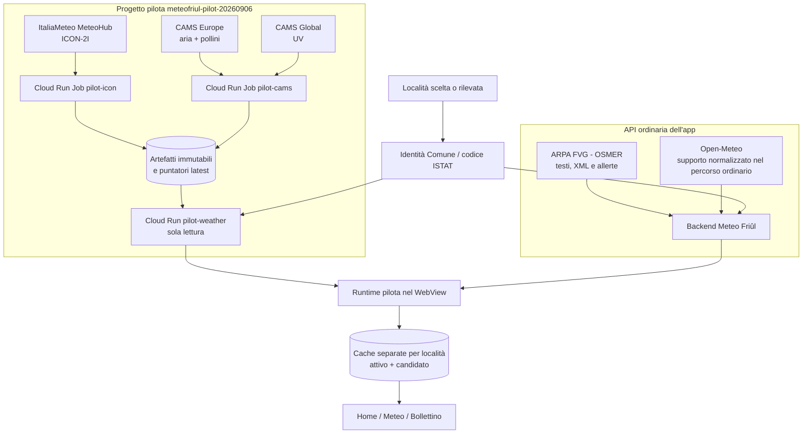
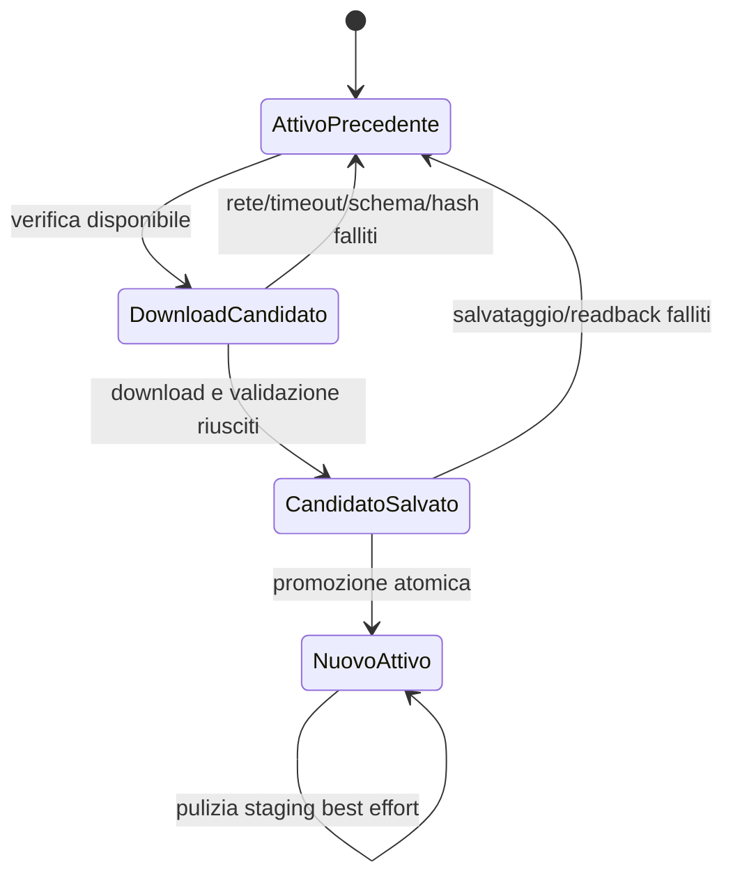

# Architettura dati dell'app pilota Meteo Eventi Friûl

**Stato descritto:** 12 settembre 2026  
**Sorgenti esaminati:** `HEAD bd68b93`  
**Applicazione:** pilota Android `com.meteofriul.app.localpilot`  
**Progetto meteo cloud esclusivo:** `meteofriul-pilot-20260906`, regione `europe-west1`

Questo documento descrive come la pilota ricava, verifica, conserva e presenta:

- meteo locale ICON-2I;
- bollettino ufficiale OSMER e allerte ufficiali regionali;
- qualità dell'aria CAMS;
- pollini CAMS;
- indice UV CAMS.

Descrive lo stato effettivo dei sorgenti alla data indicata. Non è un progetto
futuro e non implica modifiche, acquisizioni o deploy.

## 1. Sintesi dell'architettura

La pilota non usa un solo backend per tutto. Ha due piani dati distinti.

1. **Piano meteo autonomo della pilota**
   - produce ICON, aria, pollini e UV;
   - vive nel progetto cloud isolato `meteofriul-pilot-20260906`;
   - espone esclusivamente artefatti meteo pubblicati e verificati tramite il
     servizio di sola lettura `pilot-weather`;
   - non usa Firebase e non modifica l'app beta.

2. **API ordinaria dell'app**
   - fornisce bollettino OSMER, allerte ufficiali, eventi, community e altri
     contenuti applicativi;
   - è distinta dal reader meteo della pilota;
   - per il bollettino remoto segue ancora il percorso ordinario descritto nella
     sezione 5, con una precisazione importante su Open-Meteo.



Il gesto di aggiornamento nell'app **non avvia** `pilot-icon`, `pilot-cams` o una
richiesta ADS. Legge soltanto l'ultima pubblicazione già disponibile.

## 2. Mappa rapida: dato, fonte e destinazione

| Dato mostrato | Fonte originaria | Produzione/servizio | Selezione nell'app | Destinazione UI |
|---|---|---|---|---|
| Condizioni e previsione locale | ItaliaMeteo, modello ICON-2I | `pilot-icon` → storage privato → `pilot-weather` | Comune ISTAT, serie oraria reale | Home, Meteo, sintesi e andamento |
| Bollettino regionale | ARPA FVG - OSMER | API ordinaria dell'app | Testo e giorno ufficiali pertinenti | Home e Bollettino |
| Allerte regionali | Fonte ufficiale regionale | endpoint ordinario `/api/weather/official-alerts` | solo stato autorevole e azionabile | Home e Bollettino |
| Qualità dell'aria | CAMS Europe | `pilot-cams` → famiglia CAMS atomica → `pilot-weather` | nodo di griglia più vicino, ora pertinente | card Qualità dell'aria |
| Pollini | CAMS Europe | stesso job e stessa famiglia di pubblicazione dell'aria | nodo di griglia più vicino, ora pertinente | card Pollini |
| UV | CAMS Global | ramo UV di `pilot-cams` → pubblicazione UV indipendente | nodo di griglia più vicino, ora pertinente | card Indice UV |

## 3. Confine fra cloud, reader e telefono

### 3.1 I job cloud producono i dati

- `pilot-icon` scarica e materializza ICON-2I.
- `pilot-cams` gestisce aria, pollini e UV, mantenendo però indipendenti la
  pubblicazione della famiglia aria/pollini e quella UV.
- I job scrivono in un bucket privato. I payload di una corsa sono immutabili.
- Solo il piccolo puntatore `latest` viene sostituito, mediante confronto e
  scambio atomico, quando la nuova pubblicazione è completa e riletta.

Le finestre di pianificazione correnti sono:

| Job | Finestre UTC | Significato |
|---|---|---|
| `pilot-icon` | 06:00 e 18:00 | verifica/acquisizione delle corse ICON disponibili |
| `pilot-cams` | 05:00, 10:00, 15:00 e 20:00 | avanzamento controllato delle acquisizioni CAMS e recupero di richieste già avviate |

Una finestra non equivale necessariamente a una nuova pubblicazione. Se la
corsa non è pronta o la richiesta CAMS è ancora pendente, il job conserva lo
stato e una finestra successiva può riprendere il lavoro senza duplicare
l'acquisizione.

### 3.2 `pilot-weather` pubblica, ma non calcola

Il servizio Cloud Run `pilot-weather`:

- può leggere soltanto i percorsi meteo autorizzati;
- non possiede credenziali ADS;
- non avvia job e non scrive nuove corse;
- non elenca liberamente il bucket;
- verifica la catena puntatore → release/manifest → payload;
- restituisce al client soltanto artefatti referenziati da una pubblicazione
  valida.

Endpoint principali:

```text
/weather/v1/icon2i/latest.json
/weather/v1/icon2i/runs/{run-id}/manifest.json
/weather/v1/icon2i/runs/{run-id}/municipalities/{istat}.json

/weather/v1/families/cams/latest.json
/weather/v1/families/cams/runs/{run-id}/release.json
/weather/v1/cams_europe/runs/{run-id}/manifest.json
/weather/v1/cams_europe/runs/{run-id}/municipalities/{istat}.json
/weather/v1/cams_europe_pollen/runs/{run-id}/manifest.json
/weather/v1/cams_europe_pollen/runs/{run-id}/municipalities/{istat}.json

/weather/v1/uv/latest.json
```

### 3.3 Il telefono seleziona e presenta

Il runtime React/Capacitor:

1. risolve la località in una identità comunale stabile;
2. chiede gli artefatti della località al reader;
3. ricontrolla schema, identità, hash, dimensione, provenienza, corsa,
   freschezza, copertura e revoche;
4. adatta le serie verificate al modello UI;
5. salva il candidato;
6. rilegge il candidato;
7. lo promuove ad attivo solo dopo il salvataggio completo;
8. mostra il dato attivo.

## 4. Identità geografica e mappatura della località

L'identità primaria non è il nome libero digitato dall'utente, ma il Comune
risolto con il relativo codice ISTAT.

Il catalogo pilota comprende **215 Comuni** e deriva da fonti territoriali
autorevoli, fra cui catalogo ISTAT 2026 e geometrie IRDAT. Il codice ISTAT serve
anche a separare cache e richieste.

### Regola delle coordinate

- Se esiste una posizione del dispositivo con precisione e timestamp validi,
  può essere usata come punto di presentazione/selezione.
- Se quei metadati non sono affidabili o la località è manuale, viene usato il
  punto autorevole del Comune.
- La stessa regola deve essere usata nella prima costruzione e nei successivi
  riallineamenti della cache.
- Alba e tramonto sono calcolati sul punto realmente selezionato: non vengono
  alterati per far superare un confronto.

### Cambio di località

- I dati di un Comune non possono essere mostrati sotto un altro Comune.
- Le vecchie cache possono restare sul dispositivo, ma nel proprio namespace.
- Una risposta tardiva della località precedente non può sostituire il bundle
  della nuova località.
- La selezione corrente è protetta da identità ISTAT e generazione della
  richiesta.

### Limite geografico corrente

La modalità progettata “fuori FVG: solo meteo ICON” **non è ancora implementata**.
La pilota corrente usa il catalogo dei 215 Comuni FVG. Non va quindi descritta
come servizio nazionale. Bollettino OSMER, allerte, eventi, Scopri e community
restano comunque funzioni regionali anche in una futura modalità solo meteo.

## 5. Bollettino OSMER e allerte ufficiali

Il bollettino non proviene dal progetto cloud ICON/CAMS.

### 5.1 Richiesta dell'app

Il client costruisce:

```text
GET {API_BASE}/weather/forecast?city={comune}&lat={lat}&lon={lon}
GET {API_BASE}/weather/official-alerts
```

Il primo endpoint restituisce il bollettino/previsione; il secondo è separato e
restituisce lo stato delle allerte ufficiali. Un errore delle allerte non è una
prova di errore ICON o CAMS.

### 5.2 Materiale OSMER usato dal backend

Il backend raccoglie e normalizza:

- testo ufficiale italiano e friulano, quando disponibile e pertinente;
- documenti XML strutturati `PW` e `NW`;
- aree previsionali regionali `A1–A9` e zone/elementi `F1–F4`;
- simboli e fenomeni ufficiali;
- dati di emissione, validità, affidabilità e mappa;
- metadati della stazione/area usata per contestualizzare il Comune.

Il parser separa il testo ufficiale dagli elementi strutturati. Il view model
mostra soltanto testi/mappe OSMER riferibili al giorno corrente o futuro e non
trasforma un testo storico in un bollettino attuale.

### 5.3 Cache del bollettino

- ricontrollo ordinario: **5 minuti**;
- permanenza massima tecnica nella cache del dispositivo: **7 giorni**;
- la permanenza tecnica non autorizza la visualizzazione come attuale;
- il modello UI ricontrolla date, validità e stato semantico;
- dopo un errore di rete può restare visibile un bollettino ufficiale ancora
  pertinente; in assenza di un contenuto utilizzabile viene mostrato lo stato
  non disponibile.

### 5.4 Precisazione attuale su Open-Meteo

Per il meteo principale della pilota, il contratto è esplicito:

```text
local-icon-cams-v1-no-provider-fallback
```

Quindi ICON, aria e pollini **non** usano Open-Meteo come fallback.

Il bollettino remoto, tuttavia, chiama oggi l'endpoint ordinario senza il segnale
interno che selezionerebbe `get_osmer_only_forecast`. In quel percorso il backend
può ancora usare Open-Meteo come **supporto normalizzato** per date, codici e
minime/massime, pur mantenendo OSMER come fonte primaria di testo e mappa quando
questi sono disponibili.

Il payload osservabile espone infatti campi come:

```text
primary_source = arpa_fvg_osmer
fallback_used = open_meteo
model_support.open_meteo = true
```

Questa è una distinzione importante:

- non significa che il testo ufficiale OSMER venga inventato da Open-Meteo;
- significa che l'attuale percorso del bollettino non soddisfa ancora un
  requisito assoluto “zero Open-Meteo in qualunque parte della pilota”.

Esiste nel backend un loader OSMER-only, ma il percorso remoto Android corrente
non lo seleziona. Questo documento segnala la difformità; non la corregge.

### 5.5 Allerte

Le allerte sono un flusso indipendente dal bollettino e da ICON/CAMS. La pilota
espone le allerte ufficiali regionali considerate attuali e azionabili dal
contratto applicativo. Non esiste oggi un'integrazione completa delle allerte
nazionali per una modalità fuori FVG.

## 6. Meteo locale ICON-2I

### 6.1 Fonte

Fonte pubblica:

```text
https://meteohub.agenziaitaliameteo.it/nwp/ICON-2I_SURFACE_PRESSURE_LEVELS/
```

Il modello usato è **ICON-2I**. La pipeline legge file GRIB2 pubblici e verifica
parametro, livello, unità, corsa, lead temporale, griglia e semantica
dell'accumulazione.

### 6.2 Variabili acquisite

La corsa integrata usa 14 campi:

| Campo | Uso principale |
|---|---|
| `T_2M` | temperatura a 2 m |
| `TD_2M` | punto di rugiada a 2 m |
| `U_10M`, `V_10M` | velocità e direzione del vento a 10 m |
| `CLCT` | copertura nuvolosa totale |
| `PMSL` | pressione al livello del mare |
| `TOT_PREC` | precipitazione totale accumulata |
| `WW` | tempo significativo nativo ICON |
| `RAIN_CON`, `RAIN_GSP` | componenti convettiva e stratiforme della pioggia |
| `SNOW_CON`, `SNOW_GSP` | equivalente in acqua della neve |
| `GRAU_GSP` | equivalente in acqua del graupel |
| `VMAX_10M` | raffica massima a 10 m |

Ogni corsa copre **73 istanti orari**, dal lead `+0` al `+72`.

### 6.3 Derivazioni consentite

La pipeline può derivare soltanto grandezze motivate dai campi acquisiti, per
esempio:

- temperatura in °C;
- umidità relativa da temperatura e punto di rugiada;
- velocità e direzione del vento dalle componenti U/V;
- temperatura percepita tramite regole termiche dichiarate;
- incremento orario delle precipitazioni a partire dagli accumuli;
- sintesi della condizione mediante il codice nativo `WW`.

Non inventa:

- probabilità di precipitazione non calibrata;
- visibilità non acquisita;
- ore mancanti;
- valori ricostruiti per riempire buchi.

### 6.4 Dal reticolo ai Comuni

Per ogni Comune il produttore associa il punto comunale al nodo nativo ICON
pertinente e materializza un payload dedicato. L'app non scarica l'intero GRIB:
riceve soltanto il JSON del Comune selezionato.

### 6.5 Pubblicazione ICON

Ordine semplificato:

```text
indice pubblico ItaliaMeteo
  → corsa completa disponibile
  → download/decodifica dei 14 campi
  → controlli GRIB e temporali
  → materializzazione dei 215 payload comunali
  → manifest della corsa
  → rilettura completa
  → sostituzione atomica di icon2i/latest.json
```

Se la corsa è incompleta o un controllo fallisce, il puntatore non avanza.

### 6.6 Lettura e presentazione

Il client segue:

```text
latest → manifest → payload del codice ISTAT
```

e verifica nuovamente:

- schema e provider;
- identità della corsa e del Comune;
- hash SHA-256 e dimensione;
- catalogo territoriale;
- intervalli orari e copertura;
- stato di freschezza e revoche.

La UI mostra solo ore future realmente presenti. La finestra oraria è adattiva:
**da 12 fino a un massimo di 48 ore reali disponibili**, senza fabbricare il
resto. Al cambio d'ora la selezione viene rifatta dalla serie già scaricata,
anche offline.

## 7. Qualità dell'aria e pollini CAMS

### 7.1 Fonte e dataset

Dataset:

```text
cams-europe-air-quality-forecasts
```

La pipeline usa il prodotto regionale europeo, livello superficiale e
statistica ensemble median. La richiesta completa è limitata alla regione FVG,
comprende 28 variabili e 97 lead orari (`+0`…`+96`).

### 7.2 Variabili mostrate nell'app

Qualità dell'aria:

- PM2.5;
- PM10;
- ozono `O₃`;
- biossido di azoto `NO₂`.

Pollini:

- ontano;
- betulla;
- graminacee;
- artemisia;
- olivo;
- ambrosia.

Le concentrazioni sono valori modellistici. Per i pollini la pilota non applica
classi sanitarie inventate e non presenta il modello come osservazione locale.

### 7.3 Estrazione spaziale

La selezione usa il nodo nativo della griglia CAMS più vicino al punto della
località. Non viene eseguita interpolazione. Valori mancanti, non finiti o
anomali rimangono `null` o producono un esito non disponibile con flag di
qualità; non vengono sostituiti con stime arbitrarie.

### 7.4 Famiglia atomica aria + pollini

Aria e pollini sono due payload distinti, ma devono appartenere alla stessa
corsa. La release immutabile lega:

```text
cams_europe + cams_europe_pollen
```

e diventano visibili insieme tramite una sola sostituzione atomica di:

```text
weather/v1/families/cams/latest.json
```

Conseguenze:

- non si può mostrare l'aria di una corsa insieme ai pollini di un'altra;
- se uno dei due membri manca o non supera i controlli, la nuova famiglia non
  viene pubblicata;
- la precedente famiglia pubblicata rimane disponibile;
- un errore UV non impedisce questa pubblicazione.

### 7.5 Ordine di caricamento nell'app

ICON viene risolto per primo, così la schermata meteo può aprirsi senza aspettare
CAMS. Aria e pollini arrivano come supplemento differito.

Il supplemento CAMS ha un budget complessivo finito di **20 secondi** che include
le richieste preliminari, la release, i manifest e i payload necessari. Non sono
20 secondi per ogni richiesta.

Se il budget termina:

- ICON resta utilizzabile;
- il precedente CAMS attivo non viene cancellato;
- una risposta tardiva non può sovrascrivere uno stato più nuovo;
- un esito `unavailable` non viene registrato come verifica CAMS riuscita.

### 7.6 Freschezza, usabilità e campione

La policy pubblicata corrente distingue:

| Stato | Regola |
|---|---|
| fresco | corsa fino a 24 ore, entro la copertura reale |
| candidato adottabile ma stale | oltre 24 e fino a 30 ore, entro copertura e controlli |
| nuovo candidato oltre il limite | non viene promosso come nuovo dato disponibile |
| serie attiva già verificata | non viene cancellata soltanto perché non è più fresca |

Le 97 ore presenti nel file non autorizzano automaticamente a definire fresca
la corsa per 97 ore. Copertura tecnica ed età accettabile sono concetti diversi.

Al cambio d'ora il runtime cerca nella serie attiva il campione reale pertinente.
Se lo trova, aggiorna il valore anche offline. Se non esiste più un campione
pertinente, può conservare l'ultima informazione reale con il suo timestamp e lo
stato `last_known`/non attuale; non congela un numero fingendo che descriva l'ora
corrente.

La proposta separata di estendere il tetto a 35 ore non è stata approvata né
implementata: il contratto corrente resta 24/30 ore.

## 8. Indice UV CAMS

### 8.1 Fonte e trasformazione

Dataset:

```text
cams-global-atmospheric-composition-forecasts
```

Variabile:

```text
uv_biologically_effective_dose
paramId = 214002
shortName = uvbed
```

Il prodotto sorgente è un tasso istantaneo in `W/m²`. La conversione in indice
UV applicata dalla pipeline è:

```text
UVI = uvbed × 40
```

La richiesta contiene 72 ore, una griglia regionale e la corsa delle 00 UTC.

### 8.2 Pubblicazione indipendente

UV viene elaborato dallo stesso job operativo `pilot-cams`, ma ha:

- stato di acquisizione proprio;
- artefatto pubblico proprio;
- puntatore `weather/v1/uv/latest.json` proprio;
- cache attivo/candidato propria;
- timeout e frequenza di verifica propri.

Il worker può valutare il ramo UV anche quando aria/pollini non sono ancora
acquisibili. `pending` non viene trasformato in successo e non vengono create
richieste duplicate.

### 8.3 Verifica e selezione nell'app

Il documento UV deve avere:

- schema `pilot-uv-v1`;
- unità indice `1`;
- griglia geografica valida;
- esattamente 72 ore consecutive;
- valori finiti nell'intervallo ammesso;
- corsa non futura.

Un nuovo documento è adottabile entro **48 ore dalla corsa**. La selezione
spaziale usa il nodo più vicino, senza interpolazione, e rifiuta punti troppo
lontani dal dominio.

Il runtime sceglie:

- il campione che contiene l'ora corrente, se presente;
- altrimenti l'ultimo campione reale precedente, marcandolo non attuale;
- il picco giornaliero solo quando la giornata locale è completa, compresi i
  giorni da 23 o 25 ore per il cambio d'ora legale.

Giorno/notte determina esclusivamente la presentazione. Non cancella la cache,
non impedisce un download e non modifica alba o tramonto.

## 9. Modello di cache “attivo + candidato”

Questo modello è centrale per evitare card vuote durante un aggiornamento.



### Proprietà garantite

- Il dato in uso non viene cancellato prima di avere il sostituto completo.
- Il candidato viene scaricato e verificato separatamente.
- Dopo la scrittura viene riletto e confrontato byte per byte/canonicamente.
- La promozione dell'attivo avviene con una singola scrittura atomica.
- Se il processo viene interrotto, alla riapertura esiste il vecchio attivo o il
  nuovo attivo completo, non una serializzazione parziale.
- Il candidato di una richiesta vecchia non può regredire una generazione più
  nuova.
- Una revoca autorevole resta fail-closed: rimuove il componente revocato senza
  inventare continuità.

### Indipendenza dei componenti

- ICON e famiglia CAMS vengono selezionati/persistiti per componente.
- Un nuovo ICON non aspetta aria e pollini.
- Un errore del nuovo CAMS non cancella il precedente CAMS attivo.
- UV conserva e sostituisce la propria serie indipendentemente.
- Il bollettino usa una cache e un backend distinti.

## 10. Livelli di cache sul Samsung

### 10.1 Cache di oggetti verificati

Il client conserva oggetti HTTP già verificati, legati a URL, ETag/hash,
manifest padre e provider. Una risposta recuperata dalla cache per errore di
rete non rinnova artificialmente la data di verifica.

### 10.2 Prefetch nativo ICON/CAMS

La build `localPilot` contiene un plugin Capacitor e un WorkManager dedicati.

- lavoro unico: `meteofriul-pilot-weather-prefetch-v1`;
- periodo richiesto: 60 minuti;
- ritardo iniziale: 30 minuti;
- vincoli: rete connessa e batteria non bassa;
- politica `KEEP`, per non moltiplicare i worker a ogni riapertura;
- file nativi distinti per famiglia ICON e CAMS, scritti con `AtomicFile`.

Il JavaScript attende al massimo **500 ms** la disponibilità di un oggetto dal
prefetch nativo. Anche se arriva dalla cache nativa, il contenuto viene
ricontrollato dal validatore JavaScript: il prefetch accelera, non aggira le
verifiche.

Questo prefetch non è il vecchio percorso predittivo/notifiche della beta, che
viene esplicitamente disabilitato nella build pilota.

### 10.3 Bundle di visualizzazione

Il runtime conserva infine il bundle adattato per il Comune:

- identità e sorgente ICON;
- componente CAMS attivo;
- cache oraria CAMS compatta da 97 campioni;
- timestamp di verifica distinti;
- stato attuale/stale/last-known;
- diagnostica non sensibile.

UV usa chiavi Web Storage separate per attivo e candidato.

## 11. Quando l'app ricontrolla i dati

Le occasioni già esistenti comprendono:

- avvio dell'app;
- ingresso/ritorno in primo piano;
- ritorno della connettività;
- aggiornamento manuale;
- verifica periodica della pilota mentre la pagina è visibile, con finestra di
  10 minuti;
- prefetch nativo Android ogni 60 minuti, secondo i vincoli di WorkManager;
- verifica UV con intervallo massimo di 15 minuti.

Le richieste coincidenti sono deduplicate. Non è stato aggiunto polling continuo
e un esito negativo non deve bloccare ogni occasione successiva fino a un timer
arbitrario.

## 12. Primo rendering e aggiornamento differito

Sequenza semplificata di apertura:

```text
cache locale utilizzabile
  → prima UI senza vuoti
  → richiesta ICON / selezione dell'ora
  → rendering meteo
  → supplemento CAMS differito, massimo 20 s complessivi
  → aggiornamento atomico delle card aria/pollini se il candidato è valido

in parallelo:
  → richiesta bollettino + allerte all'API ordinaria
  → sottoscrizione/refresh UV indipendente
```

Questa separazione impedisce che un ritardo CAMS blocchi ICON o l'apertura
dell'app.

## 13. Refresh manuale e messaggio generale “Fallito”

Il pull-to-refresh attiva le occasioni di verifica delle route coinvolte, ma il
feedback generale non rappresenta una singola fonte. Aggrega più esiti, fra cui
route corrente e gate delle allerte ufficiali.

Esistono inoltre due budget distinti:

- circa **8 secondi** per il feedback generale del gesto;
- **20 secondi** per il supplemento CAMS differito.

Perciò “Fallito” non dimostra da solo che aria/pollini siano falliti. Il CAMS può
terminare correttamente dopo la chiusura del feedback generale, oppure il gesto
può fallire a causa di un altro componente.

Nella verifica reale del 12 settembre, CAMS è stato promosso correttamente e le
card non si sono svuotate, ma il gesto online ha comunque mostrato “Fallito”.
Alla revisione `bd68b93` questa aggregazione resta un punto aperto separato dalla
persistenza CAMS.

## 14. Comportamento in caso di errore

| Evento | Comportamento atteso |
|---|---|
| Nuova corsa non pronta | il puntatore cloud non avanza; resta pubblicata la precedente |
| Download incompleto | il candidato viene rifiutato; l'attivo resta visibile |
| Timeout CAMS | ICON continua; aria/pollini conservano l'attivo precedente |
| Errore UV | non invalida aria, pollini o ICON |
| Errore aria/pollini | non invalida UV |
| Hash/schema/provenienza non validi | candidato rifiutato, nessuna promozione |
| Salvataggio o readback fallito | attivo precedente invariato |
| App interrotta durante il salvataggio | alla riapertura vecchio o nuovo attivo completo |
| Risposta vecchia tardiva | ignorata se appartiene a una generazione superata |
| Cambio d'ora offline | nuovo campione pertinente scelto dalla serie conservata |
| Nessun campione pertinente | ultima osservazione/previsione reale marcata non attuale |
| Cambio Comune | nessun dato incrociato; cache del vecchio Comune conservata separatamente |
| Revoca autorevole | componente revocato rimosso/sanitizzato; nessuna deroga di cache |
| Bollettino non raggiungibile | cache ufficiale ancora semanticamente valida, altrimenti non disponibile |

## 15. Controlli di integrità e provenienza

La fiducia non deriva dal solo HTTP 200. La catena controlla:

- schema e versione del contratto;
- provider e dataset attesi;
- run ID e timestamp coerenti;
- Comune e codice ISTAT attesi;
- hash SHA-256 e dimensione dichiarata;
- ETag e tipo MIME nei percorsi nativi;
- appartenenza del payload al manifest;
- appartenenza dei due payload CAMS alla stessa release;
- copertura oraria senza duplicati o salti non consentiti;
- valori finiti, unità e intervalli ammessi;
- catalogo territoriale;
- freschezza/usabilità senza rinnovo implicito;
- elenchi di revoca;
- generazione della richiesta per respingere risposte tardive.

Un problema temporaneo di rete non rende “non verificato” un dato locale che era
già stato verificato e salvato. Una revoca o un difetto d'integrità, invece, ha
precedenza sulla continuità.

## 16. Cosa l'architettura non fa

- Non avvia i job cloud quando l'utente trascina per aggiornare.
- Non effettua una nuova acquisizione ADS dal telefono.
- Non interpola aria, pollini o UV.
- Non ricostruisce ore ICON mancanti.
- Non usa Open-Meteo come fallback del meteo principale ICON/CAMS.
- Non garantisce che una previsione modellistica sia un'osservazione reale.
- Non interpreta le concentrazioni polliniche come consiglio sanitario.
- Non trasforma l'assenza di una nuova pubblicazione in cancellazione della
  precedente.
- Non estende automaticamente CAMS fino alle 96 ore solo perché il payload le
  contiene.
- Non offre oggi meteo nazionale ICON, bollettini nazionali o allerte nazionali.

## 17. Percorso completo per ciascun dato

### Meteo ICON

```text
MeteoHub ItaliaMeteo
→ GRIB2 ICON-2I
→ pilot-icon
→ validazione dei 14 campi e 73 ore
→ estrazione per 215 Comuni
→ payload + manifest immutabili
→ latest atomico
→ pilot-weather
→ weatherV1Client
→ localWeatherV1Adapter
→ localWeatherV1Runtime attivo/candidato
→ Home e Meteo
```

### Bollettino OSMER

```text
ARPA FVG - OSMER
→ testi IT/FUR + XML PW/NW + mappe/metadati
→ parser_osmer / forecast_engine
→ API ordinaria /api/weather/forecast
→ bulletinApi / bulletinDataController
→ controllo data e validità nel view model
→ Home e Bollettino
```

### Aria e pollini

```text
CAMS Europe ADS
→ piano richiesta verificato 28 × 97
→ pilot-cams
→ download e decodifica regionale
→ payload aria + payload pollini della stessa corsa
→ release familiare immutabile
→ families/cams/latest atomico
→ pilot-weather
→ download differito con budget totale 20 s
→ validazione della famiglia
→ candidato persistito e riletto
→ promozione per componente
→ card Aria e Pollini
```

### UV

```text
CAMS Global ADS
→ uvbed / paramId 214002
→ pilot-cams, ramo UV indipendente
→ conversione ×40
→ documento regionale da 72 ore
→ uv/latest atomico
→ runtime UV e cache attivo/candidato separata
→ selezione del nodo e dell'ora
→ card Indice UV
```

## 18. Sorgenti principali nel repository

### Produzione e pubblicazione pilota

- `experiments/weather_autonomy/probe_icon2i.py`
- `experiments/weather_autonomy/run_pilot.py`
- `experiments/weather_autonomy/cams_request_plan.py`
- `experiments/weather_autonomy/decode_cams.py`
- `experiments/weather_autonomy/decode_cams_region.py`
- `experiments/weather_autonomy/uv_cloud.py`
- `experiments/weather_autonomy/uv_conversion.py`
- `experiments/weather_autonomy/local_pipeline/authoritative_catalog.py`
- `experiments/weather_autonomy/local_pipeline/contract_v1.py`
- `experiments/weather_autonomy/local_pipeline/publisher.py`
- `experiments/weather_autonomy/local_pipeline/http_data_plane.py`

### Runtime frontend

- `frontend/src/services/weatherV1Client.js`
- `frontend/src/services/localWeatherV1Adapter.js`
- `frontend/src/services/localWeatherV1Runtime.js`
- `frontend/src/services/camsHourlyCache.js`
- `frontend/src/services/pilotWeatherPrefetch.js`
- `frontend/src/features/weather/uvForecast.js`
- `frontend/src/features/weather/uvForecastRuntime.js`
- `frontend/src/services/bulletinApi.js`
- `frontend/src/features/bulletin/bulletinDataController.js`
- `frontend/src/features/bulletin/bulletinViewModel.js`
- `frontend/src/domain/runtime/runtimeRefreshPolicy.js`

### Backend OSMER

- `backend/app/api/weather.py`
- `backend/app/services/weather.py`
- `backend/app/weather/parser_osmer.py`
- `backend/app/weather/forecast_engine.py`
- `backend/app/services/official_alerts.py`

### Android pilota

- `frontend/android/app/src/localPilot/java/com/meteofriul/app/pilot/PilotWeatherPrefetchCore.java`
- `frontend/android/app/src/localPilot/java/com/meteofriul/app/pilot/PilotWeatherPrefetchHttp.java`
- `frontend/android/app/src/localPilot/java/com/meteofriul/app/pilot/PilotWeatherPrefetchStore.java`
- `frontend/android/app/src/localPilot/java/com/meteofriul/app/pilot/PilotWeatherPrefetchScheduler.java`
- `frontend/android/app/src/localPilot/java/com/meteofriul/app/pilot/PilotWeatherPrefetchWorker.java`

## 19. Documentazione correlata

- `WEATHER_AUTONOMY_APPROVED_DECISIONS_2026-09-04.md`
- `WEATHER_PILOT_CLOUD_ACTIVE_2026-09-06.md`
- `PILOT_ICON_AUTOMATION_2026-09-08.md`
- `PILOT_ICON_FALLBACK_2026-09-08.md`
- `PILOT_WEATHER_CACHE_2026-09-07.md`
- `PILOT_ANDROID_PREFETCH_2026-09-08.md`
- `CAMS_UV_RECOVERY_2026-09-09.md`
- `CAMS_RECOVERY_SOURCE_FIXES_2026-09-10.md`
- `CAMS_AGE_POLICY_PROPOSAL_2026-09-10.md`
- `CAMS_MANUAL_REFRESH_EPISODE_2026-09-11.md`
- `UV_PILOT_CONNECTION_2026-09-07.md`
- `../archive/ui3-migration/OSMER_DATA_PIPELINE_AUDIT.md`
- `../archive/ui3-migration/BACKEND_DATA_STATE_CONTRACT.md`

`CAMS_MORNING_DIAGNOSIS_2026-09-10.md` documenta la diagnosi storica, ma per il
comportamento corrente vanno considerate prevalenti le correzioni e le verifiche
registrate in `CAMS_MANUAL_REFRESH_EPISODE_2026-09-11.md`.

## 20. In una frase

La pilota riceve previsioni locali ICON e supplementi CAMS da una pipeline cloud
isolata che pubblica solo corse complete e verificabili; il telefono conserva
per località un attivo e prepara ogni sostituto come candidato atomico, mentre
bollettino e allerte OSMER restano su un flusso applicativo separato.
